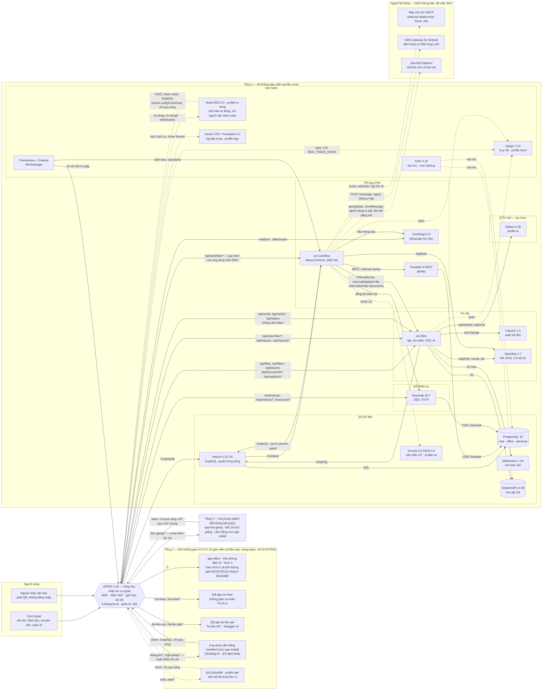
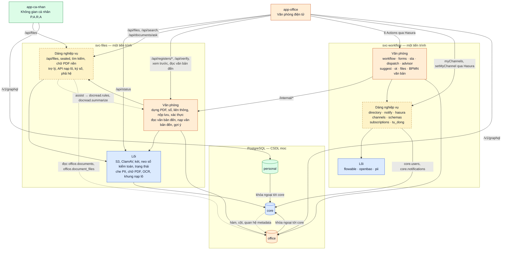

# Kiến trúc Signet

> Cập nhật 31/10/2026, theo nhánh `develop` sau bản `v1.4.0`. Tài liệu trả lời bốn câu: hệ thống gồm những gì, chạy thế
> nào, vì sao chọn như vậy, chỗ nào còn yếu. Mức hoàn thiện từng tính năng kèm bằng chứng:
> [`muc-hoan-thien.md`](muc-hoan-thien.md) — lệch với tài liệu này thì `muc-hoan-thien.md` là bản đúng. Phiên bản, giấy
> phép, thành phần đã loại: [`DEPENDENCIES.md`](../DEPENDENCIES.md). Cắm thêm ứng dụng:
> [`them-ung-dung.md`](them-ung-dung.md). Bảng, quyền, Actions: [`mo-hinh-du-lieu.md`](mo-hinh-du-lieu.md).

> **Đọc trong 10 phút** — lối đọc: [§2](#2-sơ-đồ-tổng-thể) → [§4.1](#41-trả-lời-ngắn) → [§4.2](#42-sơ-đồ) →
> [§6](#6-chỗ-còn-yếu).
>
> 1. **Gồm gì.** Lõi Tầng 1 không giao diện: phần mềm nguồn mở dùng nguyên bản (Keycloak, APISIX, Hasura, PostgreSQL,
>    Flowable, SeaweedFS, Meilisearch, ClamAV, OpenBao, Centrifugo) cộng hai dịch vụ Python của đội, `svc-files` và
>    `svc-workflow`. Tầng 2 là bốn không gian H-P-D-I có giao diện, mỗi màn hình thuộc một không gian (bảng ở
>    [`README.md`](../README.md) mục "Kiến trúc"; thành phần theo không gian ở §3): Văn phòng điện tử (một ứng dụng có
>    màn ở cả bốn không gian), Không gian cá nhân P.A.R.A (hai trang tĩnh), trang tài liệu API, và Bảng tin đơn vị, Nghỉ
>    phép (cắm bằng `moc app install`). Tầng 3, ứng dụng ngành, đề không bắt buộc: Đổi, bù lịch giảng
>    (`apps/lich-giang`) cắm cùng cách.
> 2. **Chạy thế nào.** Mọi yêu cầu vào qua một cổng APISIX có kiểm token. Dữ liệu có cấu trúc đi qua Hasura, quyền tới
>    từng dòng; tệp đi qua `svc-files`, quét ClamAV trước khi lưu; bước quy trình do Flowable giữ.
> 3. **Vì sao chọn vậy.** Không viết lại phần mềm đã có, chạy trên một máy 8 GB, không dịch vụ trả phí (§1); từng lựa
>    chọn có bản ghi QĐ-001…QĐ-013 (§5).
> 4. **Lõi đang ôm gì.** Phần máy chủ của Văn phòng điện tử chạy chung tiến trình với `svc-files`, `svc-workflow`. Thứ
>    tách cứng hiện chỉ có cổng và khóa ngoại CSDL; còn lại là chỗ dính đã liệt kê (§4).
> 5. **Yếu nhất ở đâu.** Lõi còn ôm nghiệp vụ; một máy, một PostgreSQL; trục sự kiện mới một phần (Event Triggers tới
>    ứng dụng, chưa phải broker); chưa chạy thử trên máy 8 GB thật (§6).

| Mục | Trả lời câu hỏi |
|---|---|
| [1. Nguyên tắc kiến trúc](#1-nguyên-tắc-kiến-trúc) | Chọn theo tiêu chí nào: điều phối thay vì viết lại, H → P → D → I, máy 8 GB |
| [2. Sơ đồ tổng thể](#2-sơ-đồ-tổng-thể) | Một yêu cầu đi qua những gì, cổng mở những đường dẫn nào |
| [3. Bản đồ công cụ](#3-bản-đồ-công-cụ) | Thành phần nào, phiên bản nào, nằm đâu trong repo, xong tới đâu; khe cắm nào chưa có |
| [4. Ranh giới lõi và ứng dụng](#4-ranh-giới-lõi-và-ứng-dụng) | Đâu là lõi, đâu là phần máy chủ của Văn phòng điện tử đang nằm trong dịch vụ lõi; vì sao, tách thế nào |
| [5. Bản ghi quyết định kiến trúc](#5-bản-ghi-quyết-định-kiến-trúc) | QĐ-001…QĐ-013: bối cảnh, phương án, quyết định, hệ quả |
| [6. Chỗ còn yếu](#6-chỗ-còn-yếu) | Giới hạn đã biết, mỗi dòng dẫn tới nguồn |

## 1. Nguyên tắc kiến trúc

### 1.1. Open-Core: điều phối, không viết lại

Signet **không** viết lại các phần mềm đã có bản nguồn mở trưởng thành. Nó là **lớp điều phối**
(orchestration layer) gắn kết chúng thành một hệ thống vận hành thống nhất. Giá trị của dự án
nằm ở *lớp keo* — cách các thành phần được nối, chuẩn hóa và đồng bộ — không nằm ở bản thân
các thành phần.

Hệ quả bắt buộc, áp dụng không ngoại lệ:

| Được phép | Không được phép |
|---|---|
| Kéo image thượng nguồn có ghim thẻ phiên bản và digest | Sao chép cây mã upstream vào kho này |
| Ghi đè cấu hình qua `.env` và tệp cấu hình riêng | Sửa trực tiếp mã nguồn upstream |
| Viết plugin/adapter theo cơ chế mở rộng chính thức | Fork rồi vá vào bản fork |
| Gửi patch lên chính dự án thượng nguồn | Giữ bản vá riêng không công bố |

Lý do kỹ thuật: giữ khả năng nâng cấp upstream. Lý do dự thi: tiêu chí PoF #5 trừ 5 điểm cho mỗi
vi phạm bundling và chỉnh sửa gói đính kèm.

### 1.2. Tiến hóa tuyến tính

Bốn không gian triển khai theo đúng thứ tự `[H] → [P] → [D] → [I]`. Đây là ràng buộc **nhân quả**,
không phải sở thích trình bày:

```
[H] không chuẩn hóa  →  dữ liệu bẩn ngay từ điểm nhập
[P] không ràng buộc  →  không có sự kiện có cấu trúc để [D] thu thập
[D] không hợp nhất   →  [I] đọc dữ liệu mâu thuẫn  →  ảo giác dữ liệu
```

Thứ tự này là thứ tự phụ thuộc của [`ROADMAP.md`](../ROADMAP.md) và là cách nhóm thành phần ở §3. Trong hệ thống đang
chạy, chuỗi đó đi như sau: danh tính Keycloak [H] đi trong token tới mọi lời gọi; mỗi bước nghiệp vụ [P] ghi sự kiện vào
`office.document_events` và sổ kiểm toán `core.audit_log` ngay trong giao dịch của nó; dashboard [D] đọc view trên bảng
văn bản, giao việc và sự kiện đó qua Hasura, đúng quyền người xem; tác tử [I] có danh tính riêng (vai trò Hasura
`agent`), việc của nó vào sổ kiểm toán, và nó chỉ gợi ý — người quyết.

Profile của `docker-compose.yml` chia theo **tầng**, không theo trục: `core` là Tầng 1 (16 dịch vụ, trong đó
`keycloak-fonts` chạy một lần rồi thoát), `app` là Tầng 2 (`app-office`, `app-ca-nhan`, `app-tai-lieu-api`); `make up`
bật cả hai. Phần tùy chọn có profile riêng: `ai` (Ollama), `iot` (Scorpio, PostGIS), `logs` (Vector, Parseable), `trace`
(Jaeger), `wiki` (DokuWiki), `tu-dong` (Node-RED), `mail` (Mailpit), `tunnel` (cloudflared); `ai-pull`, `iot-sim`,
`backup` chỉ dùng khi gọi `make ai-model`, `make demo-it-ot`, `make backup` hay `make restore`. Kế hoạch dời việc đổi
profile sang Phase 1, dự kiến `core / app / ops / ai` ([`ke-hoach-phat-trien.md`](du-thi/ke-hoach-phat-trien.md), cuối
Phase 0); hiện là `core`, `app` cộng các phần tùy chọn ở trên, không có profile `ops`.

### 1.3. Ràng buộc tài nguyên

Người dùng đích là SME không có đội IT và không có ngân sách phần mềm. Mọi quyết định kỹ thuật
phải qua được ba câu hỏi:

1. Chạy được trên **một máy chủ 8 GB RAM** không?
2. Người **không chuyên CNTT** cài được trong dưới một giờ không?
3. Có phụ thuộc dịch vụ **trả phí bắt buộc** nào không?

Nếu câu trả lời là *không / không / có* thì phương án bị loại, dù về mặt kỹ thuật nó tốt hơn.

Câu 1 là lý do được ghi khi loại Qdrant (QĐ-004: thêm một image và RAM) và khi chưa đưa Kestra vào
([`DEPENDENCIES.md`](../DEPENDENCIES.md): "một job mỗi giờ không đáng thêm một máy chủ Java ~1 GB RAM"). Hiện trạng
của ba câu, đúng mức đã kiểm:

| Câu hỏi | Hiện trạng | Nguồn |
|---|---|---|
| 1. Máy 8 GB | Khoảng 4,6 GiB RAM khi chạy bản 1.3.0, chưa bật mô hình; **chưa chạy thử trên máy 8 GB thật** (chi tiết dưới bảng) | README mục "Yêu cầu hệ thống"; [`trien-khai.md`](trien-khai.md) §1, §7, §8; [`du-thi/hoi-dap-hoi-dong.md`](du-thi/hoi-dap-hoi-dong.md) §9 |
| 2. Cài dưới một giờ | **Chưa đo** với người ngoài đội trên máy sạch | `ROADMAP.md`, giai đoạn 5 |
| 3. Không dịch vụ trả phí bắt buộc | Đạt | [`trien-khai.md`](trien-khai.md) §5, §5b |

- **Câu 1.** `make up` bật profile `core` và `app` (19 dịch vụ, 18 chạy liên tục). Đo bằng `docker stats` trên bản
  online 1.3.0 ngày 31/10/2026: khoảng 4,6 GiB, chưa bật mô hình; số đo cũ 3,2–3,5 GB lấy từ trước khi thêm vài dịch
  vụ. Máy đề xuất 4 vCPU, 8 GB RAM, 40 GB đĩa. Bật mô hình ngôn ngữ (profile `ai`, Ollama giới hạn mặc định 6 GB — dịch
  vụ `ollama` trong `docker-compose.yml`) thêm khoảng 3,2 GiB khi đã nạp hai mô hình mặc định, cần máy 16 GB.
- **Câu 2.** Cài từ mã nguồn bằng `make env`, `make up`, `make seed`; `make install PREFIX=…` cài ra ngoài thư mục mã
  nguồn (F1.8).
- **Câu 3.** Mô hình chạy tại chỗ; Cloudflare Tunnel chỉ là một cách lên mạng (profile `tunnel`, tắt mặc định), máy có
  IP công khai dùng Caddy.

## 2. Sơ đồ tổng thể

Vẽ theo `docker-compose.yml` và [`platform/apisix/apisix.yaml`](../platform/apisix/apisix.yaml); nhãn mũi tên ra từ cổng
là đường dẫn thật (realm mặc định `moc`). Ảnh động ở README ([`anh/kien-truc-tong-the.gif`](anh/kien-truc-tong-the.gif))
vẽ cùng hệ thống cho người mới đọc. Các nhóm [H] [P] [D] [I] theo bảng §3; `svc-files` đứng ở nhóm Tin cậy như trong
ảnh. Nét đứt là phần tùy chọn, bật theo profile hay chạy khi gọi lệnh. Kênh thông báo bên ngoài nằm ngoài mạng Docker
(cột phải của ảnh): `svc-workflow` gọi ra khi bản cài đặt cấu hình, không có gì từ đó gọi vào. Hai dịch vụ của đội
(`svc-files`, `svc-workflow`) còn chứa phần máy chủ của Văn phòng điện tử — §4 tách riêng phần đó.



- **Một cửa.** Chỉ APISIX mở cổng ra mạng (`MOC_HTTP_PORT`, mặc định 8080). Yêu cầu GET, HEAD tới đường không có trong
  danh sách trắng thì về trang của `app-office`, phương thức khác thì 404; đường quản trị và API nội bộ của thành phần
  lõi (`/admin`, `/console`, `/v1/*` ngoài `/v1/graphql`, `/v2/*`, `/flowable-rest/*`, `/metrics`, `/api/*` ngoài các
  đường trên…) trả 404 (route `chan`). Giao diện quản trị còn lại chỉ nghe 127.0.0.1 trên máy chủ: Keycloak (8180),
  Grafana (3300), Mailpit và Parseable khi bật profile của chúng.
- **Không tin mạng nội bộ.** Cổng kiểm token bằng JWKS của Keycloak; Hasura, `svc-files`, Centrifugo kiểm lại. Hasura
  gọi `svc-workflow` kèm `X-Moc-Action-Secret`; `svc-workflow` gọi `svc-files` bằng token tài khoản dịch vụ (client
  credentials). Cổng gỡ khóa quản trị Hasura khỏi mọi yêu cầu từ ngoài.
- **Hai đường ghi.** Dữ liệu có cấu trúc đi qua Hasura: quyền theo vai trò và đơn vị tới từng dòng; thao tác làm đổi
  trạng thái quy trình đi qua Hasura Actions do `svc-workflow` xử lý; ở cổng, dịch vụ này chỉ có route `/api/workflow/*`
  cho quy trình của ứng dụng cắm bằng manifest (#301), và chính nó cũng ghi qua Hasura, bằng vai trò `service`, `agent`.
  Tệp đi qua `svc-files`: quét ClamAV trước khi ghi SeaweedFS, tải về sau khi Hasura xác nhận người hỏi được xem.
- **Mạng con khép kín.** SeaweedFS chỉ ở mạng `storage`, OpenBao ở `secrets`, Ollama ở `ai` — mạng `internal` của
  Docker, chỉ `svc-files` (và `svc-workflow` với `secrets`) nối vào, nên không thành phần nào khác chạm được tệp, két
  hay mô hình qua mạng. Container ứng dụng (`app-office`, `app-ca-nhan`, `app-tai-lieu-api`, ứng dụng cài bằng
  `moc app install`) chỉ ở mạng `apps` (`internal`), nơi chỉ có APISIX: ứng dụng tới lõi duy nhất qua cổng, kể cả phần
  máy chủ của ứng dụng (token client credentials, GraphQL đi qua đúng các route của trình duyệt, cùng kiểm token, giới
  hạn tốc độ, WAF). Hasura giao sự kiện tới ứng dụng qua cổng hook 9081 của APISIX — không publish, route hook chỉ khớp
  ở cổng đó ([`them-ung-dung.md`](them-ung-dung.md) 1.3). Ngoại lệ có chủ ý: container `restic` (profile `backup`, không
  mạng) gắn thẳng volume của SeaweedFS và OpenBao để sao lưu (`docker-compose.yml`, `scripts/backup.py`). Flowable không
  gọi ra ngoài: việc tự động là việc giao ra ngoài (external worker) do `svc-workflow` kéo về (QĐ-009).

## 3. Bản đồ công cụ

Bảng thay cho danh sách "khe cắm" lúc lập kế hoạch. Phiên bản là bản ghim trong `docker-compose.yml`, Dockerfile hay tệp
khóa, như [`DEPENDENCIES.md`](../DEPENDENCIES.md) — nơi có giấy phép và digest. Cụm ①–⑦ là 7 cụm dịch vụ Tầng 1 của đề,
theo [`muc-hoan-thien.md`](muc-hoan-thien.md) §3: ① định danh, bảo mật · ② đa thuê ước, biên mạng · ③ dữ liệu có cấu
trúc · ④ dữ liệu phi cấu trúc · ⑤ quy trình, tự động hóa · ⑥ vận hành, giám sát, kiểm toán · ⑦ truyền thông, giao vận.
Cột Mức chép mã tính năng F và mức từ `muc-hoan-thien.md` (số liệu ngày 23/10), không chấm lại. Đường dẫn
`svc_files/…`, `svc_workflow/…` là `services/svc-files/src/svc_files/…`, `services/svc-workflow/src/svc_workflow/…`.
*Mã của đội* là mã viết trong repo này. Sơ đồ §2 đặt `svc-files` ở nhóm Tin cậy như ảnh GIF của README; ở đây hai dịch
vụ của đội nằm chung "Nền chung" vì cả hai phục vụ nhiều không gian.

| Không gian | Thành phần đang chạy (phiên bản ghim) |
|---|---|
| Nền chung | APISIX 3.18.0 · `svc-files`, `svc-workflow` (Python 3.13, FastAPI 0.143) · ClamAV 1.5.4 · OpenBao 2.7.1 · sổ kiểm toán chuỗi băm · pyHanko 0.37.0 · bộ che thông tin cá nhân |
| [H] Nhân sự | Keycloak 26.7.5 · Không gian cá nhân P.A.R.A (ứng dụng thứ hai) · DokuWiki 2026-07-14c (profile `wiki`) |
| [P] Quy trình | Flowable REST 8.0.0 · 9 Hasura Actions · JSON Schema dùng chung (Ajv 8.20.0, jsonschema 4.26) · Centrifugo 6.9.7 · hộp thư đi trong CSDL · nạp lô · Mailpit v1.31.4 (demo) · Node-RED 5.0.8 (profile `tu-dong`) |
| [D] Dữ liệu | PostgreSQL 16 · Hasura CE v2.51.0 · SeaweedFS 4.48 · Meilisearch CE v1.54.3 · DuckDB 1.5.6 · phả hệ OpenLineage · dashboard ECharts 6.1.0 · Scorpio 6.0.2 và PostGIS 16-3.5 (profile `iot`) |
| [I] Trí tuệ | Ollama 0.35.1 (profile `ai`) · Qwen3-1.7B, Qwen3-Embedding-0.6B · Tesseract 5.5.0 · truy xuất có nguồn tự viết · ba tác tử |
| Vận hành | Prometheus 3.15.0, Alertmanager 0.34.1, Grafana OSS 13.2.3 · Vector 0.59.0, Parseable 3.2.4 (profile `logs`) · restic 0.19.1 · reconciler GitOps · cloudflared 2026.10.0 (profile `tunnel`) |

<details>
<summary><b>Bảng chi tiết từng không gian</b>: vai trò, cụm Tầng 1, vị trí trong repo, mức</summary>

**Nền chung: cổng, tin cậy và hai dịch vụ của đội**

| Thành phần | Phiên bản | Vai trò trong Signet | Cụm | Ở đâu trong repo | Mức |
|---|---|---|---|---|---|
| Apache APISIX | 3.18.0 | Cổng duy nhất: danh sách trắng đường dẫn, kiểm JWT ở biên, giới hạn tốc độ, gắn `X-Request-Id`, xuất chỉ số cho Prometheus | ② | `platform/apisix/` | F1.2 Hoàn thiện |
| Coraza + OWASP CRS | Coraza 3.3.3, CRS 4.14.0 (coraza-proxy-wasm 0.6.0) | Tường lửa ứng dụng web trong APISIX (plugin proxy-wasm, global rule): soi mọi yêu cầu trước khi kiểm token, chặn mặc định (QĐ-013) | ② | `platform/apisix/` | F3.15 Dùng được |
| `svc-files` *(mã của đội)* | Python 3.13, FastAPI 0.143 | Cửa duy nhất của tệp, tìm kiếm, dựng PDF, cổng xác thực, trạng thái hệ thống, tác tử đọc văn bản đến và trợ lý hỏi đáp. Phân loại từng module: §4.3 | ① ④ | `services/svc-files/` | nhiều mã F — xem từng thành phần ở các bảng dưới |
| `svc-workflow` *(mã của đội)* | Python 3.13, FastAPI 0.143 | 9 Hasura Actions, nối Flowable, nhắc hạn, liên thông, thông báo đa kênh, đồng bộ danh bạ Keycloak → `core.users`, tác tử gợi ý giao việc. Phân loại: §4.3 | ⑤ ⑦ | `services/svc-workflow/` | F1.4 Hoàn thiện |
| ClamAV | 1.5.4 | Quét mọi tệp trước khi ghi (giao thức INSTREAM qua TCP); không trả lời thì từ chối, không lưu | ① | `svc_files/clamav.py` | F1.6, F3.1 Hoàn thiện |
| OpenBao | 2.7.1 | Két bí mật (static seal, AppRole cho hai dịch vụ), khóa transit `moc-files` mã hóa tệp của văn bản hạn chế, PKI nội bộ và khóa ký của từng đơn vị | ① | `platform/openbao/`, `svc_files/sealed.py`, `svc_files/signing.py` | F3.2 Hoàn thiện (mục 3 xếp két ở mức Dùng được); F3.7 Hoàn thiện |
| Sổ kiểm toán chuỗi băm *(mã của đội)* | — | Trigger `core.audit()` ghi mọi thay đổi vào `core.audit_log` nối chuỗi băm; mốc đầu chuỗi neo ra bucket khóa ghi; `make audit` kiểm lại | ⑥ | `db/migrations/default/1792281600100_core_schema/`, `svc_files/anchors.py`, `scripts/audit_chain.py` | F2.12 Hoàn thiện |
| pyHanko | 0.37.0 | Ký PAdES bản phát hành bằng khóa không rời két (QĐ-007) — chỉ minh họa | ① | `svc_files/signing.py` | F4.5 Minh họa |
| Che thông tin cá nhân *(mã của đội)* | — | Che số định danh, số điện thoại, email, số tài khoản trước khi chữ tới mô hình và nhật ký (QĐ-006) | ② | `svc_files/pii.py`, bản chép `svc_workflow/pii.py` | F4.4 Hoàn thiện |

**[H] Không gian Nhân sự**

| Thành phần | Phiên bản | Vai trò trong Signet | Cụm | Ở đâu trong repo | Mức |
|---|---|---|---|---|---|
| Keycloak | 26.7.5 | Đăng nhập một lần cho mọi ứng dụng, TOTP bắt buộc với vai trò quan trọng; vai trò, đơn vị, phòng đưa vào token (claim của Hasura); mỗi đơn vị một Organization | ① ② | `platform/keycloak/realm/moc-realm.json`, `scripts/tenants.py` | F1.1 Hoàn thiện; F3.12 Hoàn thiện |
| Không gian cá nhân P.A.R.A *(mã của đội)* | JavaScript thuần, nginx-unprivileged 1.30.6 | Ứng dụng thứ hai: mỗi người xếp tệp của mình vào Dự án, Lĩnh vực, Tài nguyên, Lưu trữ; dùng đăng nhập, tệp, sổ kiểm toán của lõi | Tầng 2 | `apps/ca-nhan/`, schema `personal` | Không có mã F; bước CI `make demo-ca-nhan` ([`them-ung-dung.md`](them-ung-dung.md) §4) |
| DokuWiki | 2026-07-14c, plugin oauth, oauthgeneric | Wiki nội bộ (profile `wiki`, tắt mặc định): mỗi đơn vị một không gian chỉ người của đơn vị đọc, sửa; đăng nhập Keycloak (client `wiki`), không tài khoản quản trị; mạng `apps`, sau APISIX ở `/wiki/` | — | `platform/wiki/`, `scripts/wiki.py` | — (#367) |

**[P] Không gian Quy trình**

| Thành phần | Phiên bản | Vai trò trong Signet | Cụm | Ở đâu trong repo | Mức |
|---|---|---|---|---|---|
| Flowable REST | 8.0.0 | Động cơ BPMN cho `van-ban-den`, `van-ban-di`: giữ bước và người phải làm, timer nhắc hạn; việc tự động giao ra ngoài cho `svc-workflow` (QĐ-009) | ⑤ | `services/svc-workflow/processes/` | F1.4, F2.3, F2.4 Hoàn thiện |
| Hasura Actions | Hasura 2.51.0 | Cửa ghi nghiệp vụ: `receiveIncoming`, `registerIncoming`, `submitOutgoing`, `completeTask` (cùng truy vấn hộp việc `myTasks` và sơ đồ cảm biến `otSensorMap` của F3.10); kênh thông báo người dùng tự bật `myChannels`, `setMyChannel` (#365); `notifyFromFlow` cho robot Node-RED, vai trò `tu_dong` (#366) → `svc-workflow`, kèm biến phiên lấy từ JWT | ⑤ | `db/metadata/actions.yaml` | F1.4 Hoàn thiện |
| JSON Schema dùng chung | Ajv 8.20.0 (giao diện), jsonschema 4.26 (`svc-workflow`) | Poka-yoke ba lớp: form, máy chủ, ràng buộc CSDL theo cùng một tệp schema | — | `schemas/` | F2.2 Hoàn thiện |
| Centrifugo | 6.9.7 | Đẩy thông báo từng người qua WebSocket `/realtime`, tự kiểm token Keycloak | ⑦ | `platform/centrifugo/config.yaml`, `svc_workflow/notify.py` | F2.5 Hoàn thiện |
| Hộp thư đi trong CSDL *(mã của đội)* | — | Liên thông văn bản giữa đơn vị (`office.dispatches`); email SMTP, webhook Mattermost, Slack, ntfy, SMS, Zalo (`core.notification_deliveries`, tắt mặc định; SMS, Zalo do từng người tự bật) (QĐ-008) | ⑦ | `svc_workflow/dispatch.py`, `svc_workflow/channels.py` | F3.12 Hoàn thiện; định tuyến thông báo đa kênh: Một phần (mục 3) |
| Nạp lô *(mã của đội)* | — | `POST /api/imports/incoming`: tệp NDJSON hoặc CSV, mỗi dòng qua ClamAV và Action `receiveIncoming` thay mặt văn thư | ⑤ | `svc_files/imports/` | Dùng được (mục 3, cụm ⑤) |
| Mailpit | v1.31.4 | Hộp thư thử cho email thông báo (profile `mail`, chỉ để demo) | ⑦ | `docker-compose.yml` | — |
| Node-RED | 5.0.8, openid-client 6.8.8 | Tự động hóa không sửa mã (profile `tu-dong`, tắt mặc định): người vận hành nền tảng soạn flow ở `/tu-dong/`; đăng nhập Keycloak, chỉ vai trò `operator` của client `tu-dong`; không node `exec`, không cài node từ trình soạn; flow tới lõi qua APISIX bằng robot của đơn vị (vai trò Hasura `tu_dong`) | ⑤ | `platform/tu-dong/`, `scripts/tu_dong.py` | — (#366) |

**[D] Không gian Dữ liệu**

| Thành phần | Phiên bản | Vai trò trong Signet | Cụm | Ở đâu trong repo | Mức |
|---|---|---|---|---|---|
| PostgreSQL | 16 | Một máy chủ CSDL: CSDL `moc` (schema `core`, `office`, `personal`), CSDL riêng `keycloak`, `flowable` (QĐ-002) | ③ | `db/migrations/default/`, `db/initdb/` | F1.3 Hoàn thiện |
| Hasura GraphQL Engine CE | v2.51.0 | GraphQL tự sinh, quyền theo vai trò và đơn vị tới từng dòng; khóa quản trị không bao giờ đi từ ngoài vào | ③ | `db/metadata/` | F1.3 Hoàn thiện |
| SeaweedFS | 4.48 | Kho tệp S3: bucket nóng `moc-files`; bucket lạnh `moc-cold` có Object Lock cho mốc neo sổ kiểm toán và gói nộp lưu (QĐ-010) | ④ | `svc_files/storage.py`, `svc_files/anchors.py`, `svc_files/archive.py` | F1.5 Hoàn thiện |
| Meilisearch CE | v1.54.3 | Tìm toàn văn văn bản, cả chữ trong PDF; chỉ mục đoạn `chunks` của trợ lý hỏi đáp (tìm lai từ khóa và véc-tơ). Chỉ trả id, Hasura quyết ai đọc được | ④ | `svc_files/search.py`, `svc_files/texts.py`, `svc_files/assist/meili.py` | F1.7, F2.7 Hoàn thiện |
| DuckDB | 1.5.6, thư viện trong `svc-files` | Ghi bảng của hồ sơ nộp lưu thành Parquet; phòng đọc đọc lại; trang Điều hành đếm văn bản đã nộp lưu trên các gói (#304) | ③ ④ | `svc_files/archive.py`, `svc_files/archive_stats.py` | F3.8 Hoàn thiện (giao diện hồ sơ, phòng đọc: #124) |
| Phả hệ dữ liệu *(mã của đội)* | OpenLineage 2-0-2, thư viện chuẩn | Sự kiện cho từng bước nộp lưu, lưu ở `core.lineage_events`; phả hệ báo cáo ← khung nhìn ← bảng tính từ catalog PostgreSQL (`office.report_lineage`), trang `/pha-he` vẽ đồ thị; Marquez chưa đưa vào | — | `svc_files/lineage.py`, migration `1792281602900_report_lineage` | F3.9 Hoàn thiện |
| Dashboard điều hành | Apache ECharts 6.1.0 | Trang `/dieu-hanh` của `app-office` đọc bốn view `office.v_*` qua Hasura, đúng quyền đơn vị | ③ | `apps/office/app/pages/dieu-hanh.vue`, migration `1792281601200_dashboard` | F3.11 Hoàn thiện |
| Scorpio Broker, PostGIS | 6.0.2, 16-3.5 | Bản sao số của cảm biến theo NGSI-LD; vượt ngưỡng thì báo `svc-workflow` (profile `iot`) | ③ | `svc_workflow/ot.py`, `services/ot-sensor/` | F3.10 Minh họa |

**[I] Không gian Trí tuệ Nhân tạo**

| Thành phần | Phiên bản | Vai trò trong Signet | Cụm | Ở đâu trong repo | Mức |
|---|---|---|---|---|---|
| Ollama | 0.35.1 | Chạy mô hình tại chỗ (profile `ai`, tắt mặc định, giới hạn 6 GB RAM); mạng `ai` không ra Internet, chỉ `svc-files` nối vào | — | dịch vụ `ollama` trong `docker-compose.yml` | phần tùy chọn của F4.1, F4.2 |
| Qwen3-1.7B, Qwen3-Embedding-0.6B | `qwen3:1.7b`, `qwen3-embedding:0.6b` | Viết trích yếu và câu trả lời có trích dẫn; nhúng đoạn và câu hỏi | — | `svc_files/docread/summarize.py`, `svc_files/assist/ai.py` | F4.1, F4.2 |
| Tesseract OCR | 5.5.0, gói Debian trong image `svc-files` | Nhận dạng chữ bản scan, ảnh chụp, chạy trong tiến trình con có giới hạn | — | `svc_files/ocr.py` | F4.1 Hoàn thiện |
| Truy xuất và trả lời có nguồn *(mã của đội)* | — | RAG tự viết: Meilisearch làm kho véc-tơ, quyền ở hai lớp, câu trích nguyên văn, kiểm trích dẫn (QĐ-004) | — | `svc_files/assist/` | F4.2 Hoàn thiện |
| Tác tử `moc-doc-reader`, `moc-assistant`, `moc-assigner` *(mã của đội)* | — | Chỉ gợi ý, người quyết; danh tính riêng (vai trò Hasura `agent`), mỗi việc vào sổ kiểm toán (QĐ-005) | — | `svc_files/docread/`, `svc_files/assist/`, `svc_workflow/advisor.py` | F4.1, F4.2, F4.3 Hoàn thiện |

**Vận hành**

| Thành phần | Phiên bản | Vai trò trong Signet | Cụm | Ở đâu trong repo | Mức |
|---|---|---|---|---|---|
| Prometheus, Alertmanager, Grafana OSS | 3.15.0, 0.34.1, 13.2.3 | Thu chỉ số của APISIX và trạng thái từng thành phần (`GET /metrics` của svc-files) mỗi 15 giây, tính luật cảnh báo; Alertmanager gọi svc-workflow để cảnh báo thành thông báo cho quản trị đơn vị (#284); Grafana chỉ nghe 127.0.0.1 | ⑥ | `platform/monitoring/` | F3.13 Dùng được |
| Vector, Parseable | 0.59.0, 3.2.4 | Log tập trung của 9 dịch vụ, che lần hai, tra theo `X-Request-Id` (profile `logs`, tắt mặc định) | ⑥ | `platform/logs/` | F3.14 Dùng được |
| restic | 0.19.1 | Sao lưu mã hóa CSDL, tệp, két (`make backup`, `make restore`) | ⑥ | `scripts/backup.py` | F3.4 Hoàn thiện |
| Reconciler GitOps *(mã của đội)* | systemd timer hoặc cron | Mỗi 60 giây khởi động lại container unhealthy, dựng lại container bị mất; khi bật GitOps thì cài commit mới của nhánh `deploy`, hoặc thẻ `vX.Y.Z` mới nhất trên `main` khi `MOC_GITOPS_FOLLOW=release`; `MOC_GITOPS_MODE=nang-cap` nâng có sao lưu và smoke, lỗi thì tự lùi về bản trước (#344, #467); kiểm chữ ký commit hoặc thẻ nếu đặt `MOC_GITOPS_ALLOWED_SIGNERS`. Hướng dẫn: `docs/van-hanh.md` | ⑥ | `scripts/reconcile.py`, `platform/systemd/` | F3.3 Hoàn thiện |
| cloudflared | 2026.10.0 | Cloudflare Tunnel cho máy không có IP công khai (profile `tunnel`, tùy chọn) | — | dịch vụ `cloudflared` trong `docker-compose.yml` | F1.9 Hoàn thiện (tunnel chưa kiểm trong CI) |

F4.7 (#121) — tự chẩn đoán mức trưởng thành H-P-D-I cho lãnh đạo (Dùng được): bảng
`office.maturity_assessments` và một trang của Văn phòng điện tử; không thêm thành phần nào, không sửa `services/`.

</details>

### Khe cắm chưa có và cách đang lấp

| Khe cắm trong kế hoạch | Hiện trạng | Đang lấp bằng | Nguồn |
|---|---|---|---|
| [H] Quản trị tri thức (wiki) | Tùy chọn (profile `wiki`, tắt mặc định) | DokuWiki ở `/wiki/`: mỗi đơn vị một không gian riêng, đăng nhập Keycloak (#367); trợ lý hỏi đáp trên kho văn bản của Văn phòng điện tử (F4.2). Chưa có không gian chung cả trường, trang wiki không vào tìm kiếm của Văn phòng | `docs/van-hanh.md` mục Wiki nội bộ; `ROADMAP.md` giai đoạn 1, 4 |
| [H] Chat nội bộ | **Chưa có** | Chuông thông báo (Centrifugo, F2.5), email, webhook tới Mattermost, Slack, ntfy, SMS, Zalo — một chiều, tắt mặc định | `ROADMAP.md` giai đoạn 1; `muc-hoan-thien.md` §3, cụm ⑦ |
| [H] Cổng nội bộ | Một phần | Các ứng dụng chung một phiên SSO, cùng tên miền sau APISIX; trang Ứng dụng (`/ung-dung`) của Văn phòng mở các ứng dụng khác, các ứng dụng kia có liên kết về Văn phòng; chưa có trang cổng riêng | `ROADMAP.md` giai đoạn 1 |
| [P] Biểu mẫu low-code | Một phần | Form của ứng dụng cắm bằng manifest khai bằng JSON Schema, trang tự dựng form (Đơn nghỉ phép, #312); form của Văn phòng viết trong mã theo JSON Schema dùng chung; khuôn văn bản đi viết trong `svc_files/render.py`; trang Dựng form (`/ung-dung/dung-form`, #403) cho quản trị đơn vị khai trường, xem trước, tải tệp JSON Schema cho ứng dụng cắm | `ROADMAP.md` giai đoạn 2 |
| [P] Tự động hóa, kịch bản serverless (⑤) | Một phần (profile `tu-dong`, tắt mặc định) | Node-RED ở `/tu-dong/` cho người vận hành nền tảng: đăng nhập Keycloak, chỉ vai trò `operator`, flow tới lõi qua APISIX bằng robot của đơn vị, hai flow mẫu (#366); chưa có webhook, bước BPMN gọi flow; vòng nền của lõi vẫn viết cứng trong `svc-files`, `svc-workflow` | `muc-hoan-thien.md` §3; `van-hanh.md` mục Tự động hóa bằng Node-RED |
| [P] Trục streaming sự kiện (⑥) | Một phần | Luồng `core.app_events` (đến, vào sổ, phát hành; không văn bản hạn chế) qua Hasura Event Triggers tới ứng dụng cài bằng `moc app install`; chưa phải broker: không phát lại, không bảo đảm thứ tự. Bảng sự kiện, hộp thư đi trong PostgreSQL (QĐ-008); Centrifugo chỉ đẩy tới trình duyệt | `muc-hoan-thien.md` §3, [`them-ung-dung.md`](them-ung-dung.md) mục 1 |
| [D] Thu thập, làm sạch, đồng bộ sang kho phân tích | **Chưa có** | Chặn dữ liệu bẩn ngay ở điểm nhập (Poka-yoke ba lớp); dashboard đọc thẳng view trên CSDL nghiệp vụ | `ROADMAP.md` giai đoạn 3 |
| [D] BI riêng | **Chưa có** (chủ ý) | Trang `/dieu-hanh` (ECharts) đọc view `office.v_*` qua Hasura. Metabase bị loại: bản nguồn mở không đăng nhập bằng Keycloak được, đọc thẳng CSDL bỏ qua quyền đơn vị | `DEPENDENCIES.md` |
| [D] Lớp ngữ nghĩa báo cáo, số liệu chuỗi thời gian (③) | Một phần | Mỗi báo cáo một view viết tay; `office.archived_document_facts` giữ số liệu của văn bản đã nộp lưu | `muc-hoan-thien.md` §3 |
| [I] Kho véc-tơ riêng | Không dùng (chủ ý) | Chỉ mục đoạn `chunks` trên Meilisearch sẵn có (QĐ-004) | `DEPENDENCIES.md` |
| [I] Cổng giám sát tác tử | **Chưa có** màn riêng | Dòng của tác tử trong sổ kiểm toán; số đo từng tác tử ở [`danh-gia-ai.md`](danh-gia-ai.md) | `ROADMAP.md` giai đoạn 4 |
| Tracing phân tán (⑥) | Một phần | Jaeger (profile `trace`, tắt mặc định, #364): span của APISIX, `svc-files`, `svc-workflow`, lưu trong RAM; chưa có span của Hasura, Flowable, Keycloak, PostgreSQL. `X-Request-Id` từ APISIX đi qua hai dịch vụ tới `core.audit_log.request_id` | `muc-hoan-thien.md` §3 |
| Dịch thuật trong lõi (②) | Một phần | Chỉ bản địa hóa giao diện tiếng Việt, tiếng Anh | `muc-hoan-thien.md` §3 |
| SMS, Zalo (⑦) | Một phần | SMS qua SMS Gateway for Android trên điện thoại cùng LAN, Zalo qua bot của đơn vị; tắt mặc định, từng người tự bật (#365). Mới thử với cổng, bot giả trong test, chưa với tài khoản thật | `muc-hoan-thien.md` §3 |

Ứng viên đã cân nhắc nhưng không dùng — vì giấy phép không thuộc danh sách OSI, của chính nó hay của phụ thuộc bắt
buộc (Vault, n8n, Redpanda, MongoDB, immudb, Directus, bpmn-js; Orion vì bắt buộc MongoDB), vì đã ngừng phát triển
(MinIO) hay vì thiếu đúng thứ cần (Metabase, PaddleOCR, Qdrant, LlamaIndex, Presidio…) — ghi kèm lý do và thứ thay ở
[`DEPENDENCIES.md`](../DEPENDENCIES.md), mục "Thành phần đã cân nhắc nhưng không dùng".

## 4. Ranh giới lõi và ứng dụng

### 4.1. Trả lời ngắn

Lõi Tầng 1 trên sơ đồ §2 gồm phần mềm nguồn mở dùng nguyên bản cộng hai dịch vụ của đội. Hai dịch vụ đó **chưa thuần
lõi**. Phần máy chủ của Văn phòng điện tử — Actions và BPMN văn bản, dựng PDF văn bản đi, sổ đăng ký, cổng xác thực,
liên thông, nộp lưu hồ sơ, đọc văn bản đến, gợi ý giao việc — chạy trong cùng tiến trình với phần lõi của `svc-files`
và `svc-workflow`. Nhiều cơ chế dùng chung (tải tệp, tìm kiếm, trợ lý, thông báo, nạp lô) còn viết cứng bảng, vai trò
hay câu chữ của Văn phòng.

Thứ đã tách cứng chỉ có hai: **cổng** — ứng dụng chỉ là client gọi lõi qua APISIX, và mạng buộc điều đó: container ứng
dụng chỉ ở mạng `apps`, nơi chỉ có APISIX (§2); **khóa ngoại CSDL** — mỗi ứng dụng có schema riêng (`office`,
`personal`), `core` không đặt khóa ngoại nào sang `office`. Phần còn lại của CSDL vẫn dính: hai hàm của `core` đọc
`office`, ba cột in văn bản đi trong `core.tenants`, hàm `core.audit_overview` viết cứng loại dòng sổ của Văn phòng, hai
tệp metadata của `core` trỏ sang `office`, năm vai trò cố định của nghiệp vụ văn thư (§4.4). Ở mức mã, bước 1–2 của
§4.7 đã làm ở #302: phần Văn phòng của hai dịch vụ nằm trong gói `office/`, chỉ gắn route và chạy vòng nền khi
`MOC_OFFICE_ENABLED` bật; tắt thì hai dịch vụ vẫn lên và phần lõi vẫn chạy (`make demo-tat-van-phong`, có trong CI). Vẫn
chung tiến trình, chung image. Như vậy vẫn đủ để ứng dụng thứ hai chạy trên lõi mà không sửa dòng nào trong `services/`,
nhưng nó mang theo các chỗ dính ở CSDL, metadata và vai trò (§4.6). Các bước còn lại là việc sau `v1.5.0` (§4.7).

### 4.2. Sơ đồ

Màu xanh dương là lõi dùng chung, cam là phần máy chủ của Văn phòng điện tử, vàng viền đứt là phần dùng chung nhưng
mang dáng nghiệp vụ, xanh lá là ứng dụng thứ hai; tiêu chí xếp ở §4.3. Mũi tên nét đứt là chỗ dính (§4.4). Mũi tên tới
schema đều đi qua Hasura (GraphQL); Actions cũng do Hasura chuyển tới `svc-workflow`.



### 4.3. Phân loại theo mã

**Tiêu chí, một cho mọi dòng:** giả sử gỡ Văn phòng điện tử đi — schema `office`, Actions, BPMN văn bản, mọi câu chữ và
giá trị của nghiệp vụ văn thư — thì phần mã đó phải làm gì?

- **Lõi:** không phải sửa dòng mã nào (chú thích không tính).
- **Dáng nghiệp vụ:** phải sửa — bỏ tên bảng, câu GraphQL, giá trị vai trò, câu chữ hay import của Văn phòng viết cứng
  trong đó — nhưng phần còn lại vẫn là cơ chế dùng được cho ứng dụng khác.
- **Văn phòng:** phần còn lại không dùng vào việc gì khác; mô-đun mất lý do tồn tại.

Xếp theo mã thật trên `9147e0f`: import nội gói, route, tên bảng, hằng số. Route xếp theo hàm xử lý của nó; mô-đun có
hai phần rõ rệt thì xếp từng phần; `__init__.py` chỉ có chú thích, không xếp. "Dính" là chỗ phải gỡ khi tách (§4.4).
Sau `9147e0f` có thêm bốn route công khai: `/api/verify/ca.pem` của #158, nộp lưu và xem tệp phòng đọc của #124 là của
Văn phòng; `/api/verify/anchor-key.pem` của #158 là của lõi (khóa công khai ký mốc neo sổ kiểm toán, cùng nhóm với
`anchors.py`). Thêm nữa có Action `otSensorMap` của IT/OT (#183) và `imageclean.py` (#150); §4.4 và §4.7 đếm theo mã
hiện tại. Nhóm của mọi mô-đun theo mã hiện tại nằm ở `NHOM` trong
[`scripts/ranh_gioi_loi.py`](../scripts/ranh_gioi_loi.py) (#484); test buộc mô-đun mới phải được xếp nhóm.

| Nhóm | `svc-files` | `svc-workflow` | Route công khai của `svc-files` (16) | CSDL |
|---|---|---|---|---|
| Lõi | 14 mô-đun và khung của `imports/runner.py`, khoảng 3 430 dòng | 3 mô-đun, khoảng 840 dòng | 1: `/api/status` | 6 bảng `core`, chuỗi băm sổ kiểm toán |
| Dáng nghiệp vụ | 19 mô-đun, khoảng 5 760 dòng | 5 mô-đun, khoảng 1 290 dòng | 8: `/api/files` (2), `/api/search`, `/api/documents/ask`, `/api/imports*` (4) | 6 bảng và một hàm của `core`; metadata `core_*.yaml` |
| Văn phòng | 10 mô-đun và `IncomingHandler`, khoảng 3 320 dòng | 8 mô-đun và 2 tệp BPMN, khoảng 2 760 dòng | 7: `/api/verify` (2), `/api/registers/*` (2), nộp lưu, xem trước, đọc văn bản đến; cả 3 route nội bộ | schema `office`, `actions.*` |
| Trộn | `app.py`, `config.py`, khoảng 1 800 dòng | `app.py`, `config.py`, khoảng 580 dòng | — | — |

Đếm bằng `wc -l` (gồm header giấy phép và chú thích) trên `9147e0f`, để thấy độ lớn: `svc-files` 14 403 dòng Python,
`svc-workflow` 5 484; không tính `__init__.py` (105 và 19 dòng); `IncomingHandler` cùng hai mutation của nó tính khoảng
165 dòng của `imports/runner.py`.

<details>
<summary><b>Bảng chi tiết từng mô-đun, từng route, từng phần CSDL</b></summary>

`svc-files` (`services/svc-files/src/svc_files/`):

| Mô-đun, route | Nhóm | Lý do |
|---|---|---|
| `auth.py` | Lõi | Kiểm JWT Keycloak; thuê ước, người dùng lấy từ claim; không import gì trong gói |
| `clamav.py` | Lõi | Máy khách clamd (INSTREAM) |
| `storage.py` | Lõi | SeaweedFS qua S3; chỉ biết `core.files` |
| `openbao.py` | Lõi | Đăng nhập AppRole, đọc bí mật của chính dịch vụ |
| `anchors.py` | Lõi | Neo đầu chuỗi sổ kiểm toán ra bucket lạnh; `core.audit_head`, `core.audit_anchors` |
| `status.py`, route `GET /api/status` | Lõi | Dò tình trạng từng thành phần; không đọc dữ liệu nghiệp vụ |
| `pii.py` | Lõi | Bộ che, chỉ thư viện chuẩn |
| `pdftext.py` | Lõi | Đọc lớp chữ PDF trong tiến trình con; không gọi CSDL |
| `assist/store.py` | Lõi | Ghi một dòng `core.audit_log` cho mỗi lượt hỏi, bằng vai trò `agent` |
| `ocr.py`, `layout.py`, `pdflayout.py` | Lõi | Tesseract trong tiến trình con có giới hạn, dựng bố cục trang; không bảng, không câu chữ nghiệp vụ. Trước #302 nằm trong gói `docread/` của Văn phòng |
| `imports/parse.py`, `imports/spool.py`, khung của `imports/runner.py` (`Importer`, `Handler`) | Lõi | Đọc NDJSON, CSV; giữ zip tạm; chạy mẻ có giữ dòng và thử lại. Loại lô do nơi gọi truyền vào (`handlers`) |
| route `POST /api/files`, `GET /api/files/{file_id}` (trong `app.py`) | Dáng nghiệp vụ | Tải lên qua ClamAV, tải về khi Hasura cho xem — đúng hai đường ứng dụng thứ hai dùng. Viết cứng của Văn phòng: nhánh `restricted` ("Văn bản hạn chế chỉ nhận tệp PDF…", đóng dấu người xem qua `sealed.py`). Dính: quyền tải về đi qua bộ lọc của `core_files.yaml`, có nhánh sang `office.document_files` |
| `sealed.py` | Dáng nghiệp vụ | Mã hóa từng tệp bằng khóa transit, đóng dấu tên người xem là cơ chế chung; lớp dấu in sẵn câu của văn bản hạn chế ("VĂN BẢN HẠN CHẾ — bản giải mã cho …"). Trước #302 gọi `docread.ocr._kill_group`, nay `ocr.kill_group` |
| `hasura.py` | Dáng nghiệp vụ | Máy khách chung (token người dùng, vai trò `service`, `agent`); câu của tìm kiếm (`CHANGED_DOCUMENTS`) còn đọc `office.documents`. Câu chỉ Văn phòng dùng (`LETTER`, `REGISTER`, `VERIFY`, `DISPATCH_SOURCE`, `VISIBLE_CASE_FILE`…) đã sang `office/hasura.py` (#302) |
| `search.py`, route `GET /api/search` | Dáng nghiệp vụ | Meilisearch xếp hạng, Hasura lọc quyền; chỉ mục và trường lọc là của `office.documents` |
| `texts.py` | Dáng nghiệp vụ | Đọc chữ PDF ở vòng nền; tệp chọn bằng `PENDING_TEXTS` theo `office.document_files`, bỏ tệp của văn bản hạn chế |
| `assist/ai.py`, `assist/meili.py`, `assist/grounding.py`, `assist/extract.py` | Dáng nghiệp vụ | Gọi mô hình, kho véc-tơ trên Meilisearch, khung lời dặn, trích câu. Viết cứng: sự kiện `office.assist.*` và tiền tố truy vấn "Vietnamese administrative documents" (`ai`), trường lọc `direction`, `type_code` (`meili`), lời dặn "trợ lý tra cứu văn bản hành chính" (`grounding`), loại văn bản (`extract`) |
| `assist/chunks.py`, `assist/index.py`, `assist/scope.py`, `assist/answer.py`, `assist/retrieve.py`, `assist/vi.py`, `assist/api.py` (route `POST /api/documents/ask`) | Dáng nghiệp vụ | Cắt đoạn, đồng bộ chỉ mục, lọc trước theo quyền, trả lời có trích dẫn; điều kiện "văn bản đủ điều kiện" và bộ lọc theo vai trò viết lại đúng `office.document_visible`. Trước #302 `vi.py`, `retrieve.py` import `fold`, `INVISIBLE_RE` từ `docread/`, nay từ `vntext.py` |
| `imports/api.py` (route `/api/imports`, `/api/imports/*`), `imports/store.py` | Dáng nghiệp vụ | API lô, bảng `core.import_jobs`, `core.import_rows` dùng chung; viết cứng `Kind = Literal["incoming"]` và câu dò trùng trên `office_documents` |
| `signing.py` | Dáng nghiệp vụ | Ký PAdES bằng khóa của đơn vị trong két; sự kiện nhật ký `office.signing.*`; chỉ `/internal/issue` gọi |
| `lineage.py` | Dáng nghiệp vụ | Dựng sự kiện OpenLineage, ghi `core.lineage_events`; tên job `moc.case_file.archive` và cột các bảng Parquet của Văn phòng viết trong mã |
| `render.py`, route `POST /internal/issue`, `GET /api/documents/{document_id}/preview` | Văn phòng | PDF văn bản đi theo thể thức NĐ 30/2020 (WeasyPrint), mã QR, mã tra cứu |
| route `GET /api/verify`, `GET /api/verify/{code}` (router `verify` của `office/api.py`) | Văn phòng | Chỉ đọc `office.issued_documents`; mã tra cứu do `/internal/issue` và `office_number_outgoing` sinh. README gọi đây là con dấu "kiểm chứng được từ bên ngoài" của lõi, nhưng gỡ Văn phòng thì route không còn gì để trả |
| `registers.py`, route `/api/registers/*` | Văn phòng | Sổ đăng ký văn bản đến, đi theo Phụ lục IV NĐ 30/2020; `office.registers`, `office.documents` |
| `dispatch.py`, route `POST /internal/dispatch-file` | Văn phòng | Chép bản phát hành sang kho của đơn vị nhận; `office.dispatches`, hàm `office.deliver_dispatch` |
| `archive.py`, route `GET /api/case-files/{case_file_id}/archive` | Văn phòng | Nộp lưu hồ sơ (`office.case_files`, hàm `office.archive_case_file`), Parquet bằng DuckDB. Sau `9147e0f`, #124 thêm `POST /api/case-files/{case_file_id}/archive` và route xem tệp trong phòng đọc |
| `archive_stats.py` | Văn phòng | Số liệu văn bản đã nộp lưu cho trang Điều hành (#304, route `GET /api/case-files/archive-stats` trong `office/api.py`): DuckDB đếm trên các bảng Parquet trong bucket lạnh, chỉ lãnh đạo đơn vị; phả hệ job `moc.archive.stats` |
| `docread/api.py` (route `POST /api/files/{file_id}/read`), `docread/reader.py`, `docread/rules.py`, `docread/summarize.py`, `docread/store.py` | Văn phòng | Tác tử đọc văn bản đến theo bố cục NĐ 30/2020, viết trích yếu, ghi `office.intake_suggestions`. `rules.fold` (bỏ dấu tiếng Việt) là hàm chung nằm trong mô-đun này |
| `IncomingHandler` và hai mutation `receiveIncoming`, `registerIncoming` trong `imports/runner.py` | Văn phòng | Mỗi dòng của lô văn bản đến đi đúng đường tiếp nhận lẻ rồi vào sổ |
| `assist/similar.py`, route `POST /internal/similar-documents` | Văn phòng | Chỉ phục vụ tác tử gợi ý giao việc của `svc-workflow` (F4.3) |
| `office/api.py` | Văn phòng | Lớp `Office` dựng tác tử đọc văn bản đến, bucket lạnh, vòng nộp lưu, `ArchiveStats`; `routers()` trả ba `APIRouter` (`documents`, `verify`, `case_files`) với 12 route Văn phòng trước khai thẳng trong `app.py` (#302) |
| `app.py`, `config.py` | Trộn | `create_app` dựng thành phần lõi, khai thẳng 5 route lõi và dáng nghiệp vụ (tải lên, tải về, tìm kiếm, `/api/status`, `anchor-key.pem`), gắn trợ lý qua `install()`. Phần Văn phòng (`office/api.py`, đọc văn bản đến, `similar`, nạp lô) chỉ dựng, gắn route, chạy vòng nền khi `MOC_OFFICE_ENABLED` bật (#302); vẫn import cả khi tắt. `Settings` chứa biến của cả ba nhóm |

`svc-workflow` (`services/svc-workflow/src/svc_workflow/`):

| Mô-đun, route | Nhóm | Lý do |
|---|---|---|
| `flowable.py` | Lõi | Máy khách Flowable REST và API external worker; tên quy trình, nhóm ứng viên do nơi gọi truyền vào |
| `openbao.py`, `pii.py` | Lõi | Bản chép của tệp cùng tên trong `svc-files` |
| `directory.py` | Dáng nghiệp vụ | Đồng bộ người dùng Keycloak → `core.users` là cơ chế chung; viết cứng `ROLES = {"clerk", "staff", "manager", "director", "tenant_admin"}` |
| `notify.py` | Dáng nghiệp vụ | Ghi `core.notifications`, đẩy qua Centrifugo; nhận `document_id`, người nhận và người được báo tiếp chọn theo vai trò văn thư (`staff` → `manager` → `director`) |
| `hasura.py` | Dáng nghiệp vụ | Máy khách vai trò `service`, `Actor` (biến phiên, cả nhóm ứng viên của BPMN văn bản), hai câu của danh bạ. 23 câu của Văn phòng (`office_register_incoming`, `office_number_outgoing`, `office_dispatches`…) đã sang `office/queries.py` (#302) |
| `channels.py` | Dáng nghiệp vụ | Kênh email, webhook, SMS, Zalo dùng chung; loại thông báo và câu chữ là của Văn phòng (`document.issued`, `task.overdue`…) |
| `schemas.py` | Dáng nghiệp vụ | Bộ kiểm JSON Schema chung; schema hiện có là form văn bản đến `schemas/van-ban-den.json` |
| `workflow.py`, route `POST /actions/{name}` | Văn phòng | Nghiệp vụ của 5 Actions: tiếp nhận, vào sổ, trình văn bản đi, hộp việc, hoàn thành việc; đối soát với Flowable |
| `forms.py` | Văn phòng | Dữ liệu của từng `formKey` trong BPMN văn bản |
| `sla.py` | Văn phòng | Nhắc hạn, báo lãnh đạo (topic `moc-sla`), ghi `office.document_events` |
| `dispatch.py` | Văn phòng | Giao từng dòng `office.dispatches` |
| `advisor.py`, `suggest.py` | Văn phòng | Tác tử gợi ý giao việc (topic `moc-goi-y`), ghi `office.assignment_suggestions` |
| `ot.py`, route `POST /ot/notify/{tenant}` | Văn phòng | Cảm biến vượt ngưỡng → dự thảo văn bản đi "Báo cáo sự cố" trong `office.documents` |
| `files.py` | Văn phòng | Gọi `/internal/issue`, `/internal/dispatch-file`, `/internal/similar-documents` của `svc-files` |
| `processes/*.bpmn20.xml` | Văn phòng | Hai quy trình `van-ban-den`, `van-ban-di` |
| `office/api.py` | Văn phòng | Lớp `Office` theo khuôn `Part`: gắn `/actions/{name}`, `/ot/notify/{tenant}`, triển khai BPMN văn bản, sáu vòng định kỳ của Văn phòng (#302) |
| `apps/` (`bpmn.py`, `forms.py`, `bundle.py`, `deploy.py`, `auth.py`, `api.py`) | Lõi | Quy trình của ứng dụng cắm bằng manifest (#301): kiểm BPMN theo danh sách trắng và form JSON Schema, triển khai lên Flowable với tiền tố `<tên>.`, API chung `/api/workflow/<tên>/…` chỉ nhận token của client `app-<tên>`. Không biết ứng dụng cụ thể nào, luôn bật, không theo `MOC_OFFICE_ENABLED` |
| `alerts.py`, route `POST /ops/alerts` | Lõi | Cảnh báo vận hành Alertmanager gửi sang (#284) → thông báo `ops.alert` cho vai trò `tenant_admin` của mọi đơn vị, không gắn văn bản; phần chung, gắn cả khi tắt Văn phòng |
| `tu_dong.py`, route `POST /actions/tu-dong/{name}` | Dáng nghiệp vụ | Kiểm kê #484: kèm văn bản thì đọc `office_documents_by_pk`, vai trò văn thư viết cứng. Action `notifyFromFlow` của robot flow Node-RED (vai trò Hasura `tu_dong`, #366) → thông báo `flow.message` cho người của đơn vị robot theo vai trò; kèm văn bản thì chỉ `director`, `clerk`; cùng khóa không báo lại |
| `parts.py` | Lõi | Khuôn `Part` (`install`, `jobs`, `aclose`) để gắn một phần nghiệp vụ; vòng định kỳ, triển khai BPMN có thử lại, định dạng lỗi Hasura Action; không biết phần cụ thể nào |
| `thoi_gian.py` | Lõi | Thời hạn ISO 8601, ngày nghỉ lễ (#489): `config.py` đọc cấu hình bằng nó; `sla.py`, `suggest.py` của Văn phòng dùng lại, đúng chiều Văn phòng → lõi |
| `app.py`, `config.py` | Trộn | `create_app` dựng phần chung (danh bạ, thông báo: hai vòng định kỳ) và quy trình của ứng dụng (`apps/`, #301); chỉ dựng và gắn phần Văn phòng khi `MOC_OFFICE_ENABLED` bật (#302). Gói tự mô tả là "Hasura Actions của Văn phòng điện tử" (`__init__.py`) |

CSDL và metadata Hasura:

| Phần | Nhóm | Lý do |
|---|---|---|
| `core.files`, `core.audit_head`, `core.audit_anchors`, `core.file_signatures`, `core.notification_deliveries`, `core.lineage_events`; chuỗi băm của `core.audit_log`, trigger `core.audit()` | Lõi | Không cột, giá trị hay hàm nào của Văn phòng |
| `core.tenants`, `core.users`, `core.notifications`, `core.file_texts`, `core.import_jobs`, `core.import_rows`; hàm `core.audit_overview` | Dáng nghiệp vụ | Từng phần ở danh sách dưới bảng |
| Metadata của `core` (`db/metadata/databases/default/tables/core_*.yaml`) | Dáng nghiệp vụ | `core_files.yaml` có quan hệ và nhánh lọc quyền qua `office.document_files`; `core_audit_log.yaml` dùng hàm `office.audit_overview_seen`, `office.audit_log_visible` để ẩn văn bản hạn chế |
| Schema `office` (văn bản, giao việc, sổ, phòng ban, hồ sơ, liên thông, gợi ý của tác tử, góp ý, view `v_*`), `db/metadata/actions.*` | Văn phòng | Ứng dụng đầu tiên. Phòng ban (`office.departments`) cũng nằm ở đây dù token nào cũng mang `department_id` |
| Schema `personal` | Ứng dụng thứ hai | Một bảng `personal.items`, quan hệ một chiều về `core.files` |

- `core.tenants`: migration của Văn phòng `1792281600500_outgoing` thêm `parent_name`, `place_name`, `head_title` để in
  văn bản đi.
- `core.users`: cột `role` chỉ nhận 5 giá trị (`clerk`, `staff`, `manager`, `director`, `tenant_admin`); bốn giá trị đầu
  là vai trò của nghiệp vụ văn thư.
- `core.notifications`: `document_id` là id văn bản (không khóa ngoại).
- `core.file_texts`: hàm `core.file_texts_skip_restricted` đọc `office.documents`, `office.document_files`.
- `core.import_jobs`, `core.import_rows`: `kind` chỉ nhận `incoming`.
- `core.audit_overview` (cột nào hiện trên màn Sổ kiểm toán): viết cứng tên cột, hành động của Văn phòng; 10 migration
  định nghĩa lại hàm này, từ `1792281600700_audit_anchors` tới `1792281604100_assistant_route`, phần lớn là của Văn
  phòng.

</details>

### 4.4. Chỗ dính đã biết

Danh sách phải gỡ trước khi tách (§4.7). Kiểm kê tự động trên mã hiện tại: `python3 scripts/ranh_gioi_loi.py` đọc mã
Python của hai dịch vụ, migration và metadata Hasura, in mọi chỗ lõi → Văn phòng theo năm mặt (import, dữ liệu, CSDL,
metadata, vai trò); danh sách đã biết ở [`scripts/ranh_gioi_loi.txt`](../scripts/ranh_gioi_loi.txt), nhóm theo thứ
tự tách. `make test` (CI) là chốt chặn lùi: chỗ dính mới thì đỏ, chỗ đã gỡ mà danh sách còn cũng đỏ, nên danh sách
chỉ ngắn dần; mô-đun nhóm lõi không được có chỗ dính nào (#484). Kiểm kê #484 thêm bốn chỗ ngoài những gì đã viết dưới
đây: trigger `notifications_restricted` trên `core.notifications` chạy hàm `office.notifications_restricted` (che nội
dung văn bản hạn chế trong thông báo, phải còn tác dụng sau mọi bước tách); `tu_dong.py` đọc `office.documents` khi
robot báo kèm văn bản; `config.py` của `svc-workflow` import `sla.py`, `suggest.py` của Văn phòng; quyền Hasura của
tám bảng `core` và bảy mô-đun dùng chung viết cứng vai trò văn thư.

- **Mã.** Theo `docs/api/openapi/svc-files.json` có 20 route công khai — 2 lõi, 8 dáng nghiệp vụ, 10 Văn phòng — cộng
  3 route nội bộ đều của Văn phòng. Đã gỡ ở #302. Bước 1 của §4.7: mô-đun dáng nghiệp vụ không còn gọi vào gói
  `docread/` của Văn phòng — `kill_group`, `killed` nằm ở `ocr.py`; `fold`, `DASHES`, `DATE`, `SYMBOL`, `INVISIBLE_RE` ở
  `vntext.py`; ba mô-đun lõi `ocr.py`, `layout.py`, `pdflayout.py` ra gói gốc. Câu GraphQL chỉ Văn phòng dùng sang
  `svc_files/office/hasura.py`, `svc_workflow/office/queries.py`. Bước 2: 12 route Văn phòng của `svc-files` sang ba
  `APIRouter` trong `svc_files/office/api.py`; Actions, `/ot/notify/{tenant}`, BPMN và vòng định kỳ của Văn phòng trong
  `svc-workflow` sang lớp `Office` (`svc_workflow/office/api.py`, khuôn `parts.py`); cả hai chỉ gắn khi
  `MOC_OFFICE_ENABLED` bật. Từ #489 `app.py` của hai dịch vụ chỉ nạp gói Văn phòng (cùng WeasyPrint) bên trong
  `create_app` khi cờ bật, `config.py` của `svc-workflow` không còn kéo theo `sla.py`, `suggest.py`; test mỗi dịch vụ
  kiểm trong tiến trình riêng rằng tắt cờ thì không mô-đun Văn phòng nào được nạp. Còn lại: khi tắt, `svc-files`
  vẫn dò két cho ký số lúc khởi động và `/readyz` báo `"ai": false` (cờ này lấy từ tác tử đọc văn bản đến).
- **Phạm vi.** Tìm kiếm, đọc chữ PDF, chỉ mục đoạn của trợ lý chọn dữ liệu từ `office.documents`,
  `office.document_files`: tệp của ứng dụng khác (vd trong `personal`) không tìm được, trợ lý không đọc tới.
- **Tệp và quyền xem tệp.** Route `/api/files` có nhánh `restricted` của văn bản hạn chế. Bộ lọc quyền của `core.files`
  trong `core_files.yaml` có nhánh qua `office.document_files`; ứng dụng nào tải tệp về cũng đi qua bộ lọc đó.
- **Vai trò.** `core.users.role` và `ROLES` của `directory.py` chỉ nhận năm vai trò, bốn trong đó là vai trò văn thư.
  Token chỉ mang một trong năm vai trò đó, nên quyền của ứng dụng thứ hai (`personal_items.yaml`) cũng gắn vào bốn vai
  trò văn thư; quản trị đơn vị (`tenant_admin`) không đọc `core.files` nên không có không gian cá nhân
  ([`them-ung-dung.md`](them-ung-dung.md) §4, §6).
- **CSDL.** Hàm `core.file_texts_skip_restricted` nằm ở schema `core` mà đọc `office.documents`,
  `office.document_files`; trigger `core.app_events_publish()` trên `office.document_events` đọc `office.documents`, và
  `core.app_events.kind` chỉ nhận ba loại `office.document.*` (migration `1792281603200_app_registry`); migration
  `1792281600500_outgoing` của Văn phòng thêm ba cột vào `core.tenants`; 10 migration định nghĩa lại
  `core.audit_overview` mỗi khi thêm loại dòng sổ; `core.import_jobs.kind` chỉ nhận `incoming`.
- **Metadata Hasura.** `core_files.yaml`, `core_audit_log.yaml` trỏ sang `office` — ngược với quy tắc đặt cho ứng dụng
  mới: "không thêm quan hệ vào metadata của lõi" ([`them-ung-dung.md`](them-ung-dung.md) §3, bước 6).
- **Vận hành.** Dựng PDF, OCR (tiến trình con), nộp lưu chạy chung container với tải tệp lên của mọi ứng dụng; triển
  khai lại phần Văn phòng là khởi động lại cả `svc-files` hay `svc-workflow`. `MOC_OFFICE_ENABLED=false` để kiểm lõi
  đứng được một mình, không phải cách vận hành: giao diện Văn phòng vẫn được phục vụ nhưng route của nó trả
  404, Action Hasura của nó báo lỗi.

### 4.5. Vì sao đang gộp

Lý do có ghi lại trong repo:

1. **Kế hoạch giao việc như vậy từ đầu.** [`ke-hoach-phat-trien.md`](du-thi/ke-hoach-phat-trien.md) §2.2 giao
   `svc-files` cả "dựng PDF văn bản đi từ mẫu, chèn số, ký hiệu, mã QR; API xác thực văn bản", giao `svc-workflow`
   "Xử lý Hasura Actions, cấp số theo sổ". Văn phòng điện tử là ứng dụng duy nhất cho tới khi có Không gian cá nhân
   P.A.R.A (#89).
2. **Không thêm dịch vụ khi dịch vụ sẵn có đã giữ thứ cần dùng.** Phần AI được dự kiến là dịch vụ `svc-ai` riêng (kế
   hoạch §2.2) nhưng vào `svc-files` vì "`svc-files` đã có client Meilisearch, client Hasura, chữ PDF của F2.7, mạng
   `ai`; không thêm image, gói Python, route gateway nào" (QĐ-004). Kestra chưa đưa vào: nộp lưu chạy thành vòng nền
   trong `svc-files` vì "một job mỗi giờ không đáng thêm một máy chủ Java ~1 GB RAM"
   ([`DEPENDENCIES.md`](../DEPENDENCIES.md)) — câu 1 của §1.3.
3. **Byte tệp chỉ có ở `svc-files`.** SeaweedFS chỉ ở mạng `storage` mà chỉ `svc-files` nối vào, không phát URL ký sẵn
   (QĐ-010). Việc nào cần đọc hay ghi tệp — dựng bản phát hành, đọc văn bản đến, nộp lưu, liên thông — hoặc nằm trong
   `svc-files`, hoặc phải gọi nó; `docread/api.py` ghi rõ "không qua Hasura action: byte tệp chỉ có ở svc-files".
4. **Ứng dụng là trang tĩnh, không có máy chủ riêng** (QĐ-011): logic phía máy chủ của Văn phòng phải nằm ở Hasura
   (quyền, hàm SQL, Actions) hoặc trong một dịch vụ.

Gộp cũng cho vài lợi ích đang dùng — đây là hệ quả, không phải lý do đã ghi: một bộ kiểm token, một máy khách Hasura với
vai trò `service`, `agent`, một sổ kiểm toán; lời gọi giữa hai phần là gọi hàm, không thêm chặng mạng hay token. Không
có bản ghi nào cho thấy phương án "mỗi ứng dụng một dịch vụ máy chủ riêng" đã được cân nhắc lúc bắt đầu.

### 4.6. Bằng chứng: ứng dụng thứ hai không đụng phần của Văn phòng

Không gian cá nhân P.A.R.A không đụng dòng **Văn phòng** nào ở §4.3. Nó dùng `POST /api/files`, `GET
/api/files/{file_id}` của `svc-files`, `/v1/graphql` trên schema riêng `personal` (quan hệ một chiều về `core.files`),
cùng đăng nhập Keycloak, cổng APISIX, trigger sổ kiểm toán `core.audit()`. Trong đó hai thứ còn mang dáng văn thư, đúng
như §4.3, §4.4 đã xếp: hai route `/api/files` và bộ lọc quyền của `core.files` (`core_files.yaml`, có nhánh qua
`office.document_files`); và bốn vai trò Hasura `clerk`, `staff`, `manager`, `director` mà quyền của `personal.items`
gắn vào (`personal_items.yaml`) — `tenant_admin` không đọc `core.files` nên không có không gian cá nhân. Lúc thêm ứng
dụng này, `git diff --stat` trên `services/`, `apps/office/`, các migration có từ trước, `core_*.yaml`, `office_*.yaml`,
`actions.*` đều không in dòng nào ([`them-ung-dung.md`](them-ung-dung.md) §5). Kiểm trên hệ thống chạy: `make
demo-ca-nhan`, có trong CI. Giới hạn của bằng chứng này: tải lên của P.A.R.A vẫn chạy trong tiến trình `svc-files` có
phần Văn phòng — tách về đường đi của mã và dữ liệu, chưa tách về tiến trình.

Ứng dụng thứ ba, Bảng tin đơn vị (`apps/bang-tin`), đi xa hơn một bước: cài bằng `moc app install` từ manifest, không
sửa tệp nào của lõi — client Keycloak, route APISIX, metadata Hasura nằm trong `.moc-apps/` ngoài git. Migration chạy
bằng vai trò CSDL riêng không có quyền trên `core`, `office`, `personal`; ứng dụng biết văn bản vừa vào sổ qua luồng
`core.app_events` chứ không dò bảng của Văn phòng; trang chỉ đọc số ký hiệu, trích yếu, chiều văn bản qua quan hệ
GraphQL tới `office.documents`, theo quyền của người đang xem (`apps/bang-tin/app.yaml`). Container của nó chỉ ở mạng
`apps`: nhận sự kiện qua cổng hook của APISIX, lấy token, ghi GraphQL qua cổng công khai như trình duyệt. Kiểm trên hệ
thống chạy: `make demo-cai-ung-dung`, có trong CI ([`them-ung-dung.md`](them-ung-dung.md) mục 1).

### 4.7. Hướng tách

Bước 1–2 đã làm ở #302; bước 3–5 là việc sau `v1.5.0`, chưa xếp ngày (#324).

**Tiêu chí xong** — kiểm được, không cần tin lời:

1. Gói lõi không import gói nào của Văn phòng (`git grep` các dòng `from .docread`, `from .render`… trong mô-đun lõi
   không in gì). **Đạt ở #302**; chỗ ráp `app.py` của hai dịch vụ (nhóm "Trộn" ở §4.3) chỉ nạp `office` khi cờ bật
   từ #489.
2. Không còn hàm, cột, quan hệ metadata nào của `core` trỏ sang `office`; quyền xem `core.files` không phụ thuộc bảng
   nào của `office`.
3. Vai trò của một ứng dụng là của ứng dụng đó: ứng dụng mới khai vai trò riêng mà không sửa `core.users.role` hay
   `directory.py`.
4. Tắt phần Văn phòng bằng cấu hình thì `svc-files`, `svc-workflow` vẫn lên; phần lõi của `make smoke` và
   `make demo-ca-nhan` vẫn xanh. **Đạt ở #302**: `MOC_OFFICE_ENABLED=false`, kiểm bằng `make demo-tat-van-phong` trong
   CI.
5. Ứng dụng thứ ba có tìm kiếm và thông báo cho dữ liệu của mình mà không đọc bảng `office`.

Tiêu chí 1, 2, 3, 5 đo được bằng [`scripts/ranh_gioi_loi.txt`](../scripts/ranh_gioi_loi.txt): đạt khi các nhóm dòng
tương ứng của tệp đó trống (#484).

**Bước**, mỗi bước một pull request, luồng chính (smoke, e2e) giữ xanh:

1. Gỡ chỗ dính trong mã: đưa `_kill_group`, `_killed`, `fold` (cùng `DASHES`, `DATE`, `SYMBOL`), `INVISIBLE_RE` và
   ba mô-đun lõi của `docread/` sang chỗ chung;
   tách câu GraphQL của Văn phòng khỏi hai tệp `hasura.py`. **Đã làm ở #302.**
2. Tách router: khuôn `install(app, …)` đã có ở bốn mô-đun, nên phần còn phải dời là 12 route Văn phòng đang khai thẳng
   trong `app.py` (xem trước, hai route sổ, ba route xác thực, bốn route nộp lưu, `/internal/issue`,
   `/internal/dispatch-file`; `/api/verify/anchor-key.pem` là của lõi, ở lại)
   sang `APIRouter` riêng (vd gói `svc_files/office/`; Actions của `svc-workflow` cũng vậy); `create_app` chỉ
   `include_router` và chạy tác vụ nền của Văn phòng khi phần đó được bật. **Đã làm ở #302**, cờ
   `MOC_OFFICE_ENABLED` (mặc định bật); OpenAPI sinh ra của hai dịch vụ không đổi.
3. Dọn CSDL: dời `core.file_texts_skip_restricted` và trigger `core.app_events_publish` sang schema `office`; cột in văn
   bản đi của `core.tenants` sang một bảng của `office`; danh sách trắng của `core.audit_overview` thành dữ liệu mỗi ứng
   dụng tự thêm dòng; nhánh `office.document_files` trong bộ lọc quyền của `core.files` và năm vai trò cố định của
   `core.users.role` thành thứ ứng dụng tự khai; nguồn dữ liệu của tìm kiếm, chữ PDF, chỉ mục đoạn thành thứ ứng dụng
   khai báo (vd một view theo quy ước tên) thay vì truy vấn viết cứng trên `office.documents`.
4. Đóng gói phần Văn phòng thành gói Python riêng trong repo; vẫn chạy chung tiến trình.
5. Khi 1–4 xong và có lý do vận hành (tải riêng, phát hành riêng): chạy phần Văn phòng thành dịch vụ riêng, gọi lõi qua
   API như mọi ứng dụng.

**Cái giá:**

- Bước 5 thêm ít nhất một container và một tiến trình Python thường trực trên máy 8 GB; RAM của nó chưa đo.
- Lời gọi đang là gọi hàm trong tiến trình (dựng bản phát hành cần byte tệp và két, đọc văn bản đến cần tệp) thành lời
  gọi mạng có token dịch vụ: thêm độ trễ, thêm chỗ hỏng. Phần Văn phòng tách ra không vào được mạng `storage`,
  `secrets`, nên phải đi qua API của `svc-files` — hoặc nối thêm mạng, làm yếu QĐ-010.
- Compose, `make install`, reconciler, CI (dựng image, smoke, e2e, sinh tài liệu API) thêm một dịch vụ để giữ.
- Trong lúc tách, rủi ro hồi quy dồn vào đúng luồng chính đang dùng để trình diễn.

## 5. Bản ghi quyết định kiến trúc

Mỗi lựa chọn công cụ được ghi lại theo mẫu: *bối cảnh → phương án đã cân nhắc → quyết định → hệ quả*.

QĐ-001…QĐ-007 giữ nguyên văn lúc ghi. QĐ-008…QĐ-012 ghi lại những quyết định đã làm, có trong mã, mà trước đây chưa có
bản ghi; QĐ-013 ghi WAF, gộp ở #130. Câu nào của QĐ cũ đã lệch với hiện trạng thì ghi ở bảng dưới, không sửa vào QĐ.

| QĐ | Câu lúc ghi | Hiện trạng |
|---|---|---|
| QĐ-001 | "mọi tệp mã phải mang header Apache-2.0 (CI cưỡng chế)" | Vẫn đúng với tệp mã; tệp không chèn được header (JSON, ảnh, Markdown…) khai giấy phép trong `REUSE.toml` |
| QĐ-002 | "dùng chung cho mọi thành phần, tách bằng schema hoặc database riêng" | Đúng, trừ Scorpio: broker bắt buộc phần mở rộng `postgis` nên có CSDL PostGIS riêng (profile `iot`) |
| QĐ-002 | "tài liệu vận hành ở giai đoạn 5 phải có quy trình sao lưu và phục hồi rõ ràng" | Đã có: `make backup`, `make restore` (restic, F3.4), [`van-hanh.md`](van-hanh.md) mục "Sao lưu và khôi phục" |
| QĐ-003 | "Cần điều phối khoảng 8–12 dịch vụ"; "profile theo trục" | `make up` dựng 19 dịch vụ (16 của `core`, 3 của `app`), 18 chạy liên tục, `keycloak-fonts` chạy một lần; profile chia theo tầng và phần tùy chọn (§1.2) |

### QĐ-001: Chọn Apache-2.0 làm giấy phép dự án

- **Bối cảnh:** Signet lắp ghép nhiều phần mềm thượng nguồn có giấy phép khác nhau. Tiêu chí chấm
  điểm PoF #2 trừ 5 điểm nếu *"mã nguồn tự thân chứa sự không tương thích của các giấy phép"*.
- **Phương án:** MIT (đơn giản nhất) · Apache-2.0 (permissive, có điều khoản sáng chế) ·
  GPL-3.0 / AGPL-3.0 (copyleft mạnh).
- **Quyết định:** Apache-2.0.
- **Lý do:** permissive nên gần như không thể phát sinh xung đột với giấy phép của các thành phần
  thượng nguồn; có điều khoản cấp phép sáng chế rõ ràng (MIT không có); có quy ước header chuẩn
  cho từng tệp — đúng thứ tiêu chí PoF #2 đòi hỏi. Copyleft mạnh bị loại vì rủi ro tương thích khi
  liên kết với thành phần permissive, và vì cản trở SME tích hợp vào hệ thống sẵn có của họ.
- **Hệ quả:** mọi tệp mã phải mang header Apache-2.0 (CI cưỡng chế); thành phần mang giấy phép
  copyleft chỉ được dùng ở dạng **dịch vụ độc lập giao tiếp qua mạng**, không liên kết mã.

### QĐ-002: Chọn PostgreSQL làm CSDL nền

- **Bối cảnh:** Trục [D] cần một CSDL quan hệ làm nơi trú của nguồn sự thật duy nhất; các thành
  phần ở [H] và [P] cũng cần CSDL riêng.
- **Quyết định:** PostgreSQL 16 (image chính thức `postgres:16-alpine`), dùng chung cho mọi thành
  phần, tách bằng schema hoặc database riêng.
- **Lý do:** hầu hết ứng viên ở cả bốn trục đều hỗ trợ PostgreSQL; gộp về một hệ quản trị giúp
  giảm dung lượng RAM — yếu tố quyết định với ràng buộc 8 GB; giấy phép PostgreSQL License
  (permissive) tương thích Apache-2.0; sao lưu và phục hồi đơn giản cho SME không có DBA.
- **Hệ quả:** PostgreSQL trở thành điểm lỗi đơn (single point of failure) — tài liệu vận hành ở
  giai đoạn 5 phải có quy trình sao lưu và phục hồi rõ ràng.

### QĐ-003: Điều phối bằng Docker Compose, không dùng Kubernetes

- **Bối cảnh:** Cần điều phối khoảng 8–12 dịch vụ.
- **Quyết định:** Docker Compose v2 với profile theo trục.
- **Lý do:** SME không có đội vận hành Kubernetes; Compose cài trong một lệnh, đọc hiểu được bởi
  người không chuyên; profile ánh xạ trực tiếp sang bốn không gian H-P-D-I, giúp nghiệm thu từng
  tầng theo đúng lộ trình tuyến tính.
- **Hệ quả:** không có tự động mở rộng theo tải và không có khả năng chịu lỗi đa node — chấp nhận
  được với quy mô một SME; ghi rõ giới hạn này trong tài liệu vận hành.

### QĐ-004: Trợ lý hỏi đáp dùng lại Meilisearch tìm lai, tự viết đường ống, không Qdrant / LlamaIndex

- **Bối cảnh:** F4.2 — người dùng hỏi bằng câu tự nhiên trên kho văn bản, câu trả lời phải kèm số ký hiệu và trang,
  và chỉ dựa trên văn bản người hỏi được xem. Kế hoạch ban đầu: Qdrant (kho véc-tơ) + bge-m3 + LlamaIndex trong một
  dịch vụ `svc-ai` mới. Ràng buộc: máy 8 GB, CI không có mô hình nào, văn bản hạn chế (F3.7) không bao giờ được lộ.
- **Phương án kho truy xuất:** Qdrant — thêm image và RAM, kho thứ hai phải đồng bộ thuộc tính quyền, không tìm theo
  từ khóa tiếng Việt nên CI vẫn cần đường khác. pgvector — lọc quyền bằng đúng hàm `office.document_visible`, nhưng
  phải thay image PostgreSQL của lõi bằng image tự dựng, và PostgreSQL không có cấu hình chữ tiếng Việt. Meilisearch —
  đã chạy (F1.7), đã bỏ dấu tiếng Việt, bản CE (MIT) có tìm lai từ khóa + véc-tơ, F2.7 đã có mẫu lọc thuê ước + hậu
  kiểm; không có join nên thuộc tính quyền phải chép vào từng đoạn.
- **Phương án khung:** LlamaIndex kéo 28 gói phụ thuộc trực tiếp, NLTK và tiktoken tải dữ liệu từ Internet lúc chạy
  (mạng `ai` không ra Internet), và không biết quyền của Signet — lọc quyền, trích dẫn, kiểm câu trả lời vẫn phải
  tự viết.
- **Quyết định:** chỉ mục đoạn Meilisearch `chunks` (một tài liệu mỗi đoạn, mỗi đoạn biết trang của nó), embedder
  `userProvided`: `svc-files` tự gọi Ollama `/api/embed` (Qwen3-Embedding-0.6B, đổi sang bge-m3 bằng một biến). Không
  dùng nguồn nhúng `ollama` của Meilisearch: Meilisearch sẽ phải vào mạng `ai`, và khi không có mô hình (CI) cả lô
  thêm tài liệu lỗi, hỏng luôn đường từ khóa. Đường ống (cắt đoạn, lọc quyền, câu trích, gọi mô hình, kiểm trích dẫn)
  tự viết trong gói `svc_files/assist/` — `svc-files` đã có client Meilisearch, client Hasura, chữ PDF của F2.7, mạng
  `ai`; không thêm image, gói Python, route gateway nào.
- **Quyền ở bước truy xuất, hai lớp, cả hai đứng trước mô hình và trước người dùng:** (1) lọc trước trong Meilisearch
  theo vai trò, đúng như `office.document_visible` — văn bản hạn chế không bao giờ vào chỉ mục; (2) hậu kiểm bằng
  Hasura với token người hỏi, bỏ mọi đoạn của văn bản người hỏi không đọc được hoặc `restricted`. Lớp 1 quyết độ phủ,
  lớp 2 quyết an toàn: chỉ mục chậm vài giây sau khi bật hạn chế hay hủy giao việc vẫn không lộ đoạn nào. Không có
  đoạn nào qua hậu kiểm thì mô hình không đọc chữ nào của văn bản, chỉ diễn đạt lại lời báo không tìm thấy.
- **Hệ quả:** không có mô hình (CI, máy yếu) vẫn chạy đủ: tìm theo từ khóa + câu trích nguyên văn. Câu trả lời của mô
  hình chỉ hiện khi qua kiểm trích dẫn và con số, không thì trả câu trích. Đồng bộ chỉ mục đoạn là việc của
  `svc-files` (vòng nền, như F2.7). F4.3 (gợi ý giao việc) dùng lại phần truy xuất này qua route nội bộ
  `POST /internal/similar-documents`, vai trò `service` (QĐ-005). Chi tiết:
  `docs/mo-hinh-du-lieu.md` §3, README của `svc-files`.

### QĐ-005: Tác tử gợi ý giao việc: nhánh BPMN song song, kNN trên Retriever F4.2, không mô hình

- **Bối cảnh:** F4.3 — văn bản đến vừa vào sổ, lãnh đạo đơn vị mở việc "Cho ý kiến chỉ đạo" đã thấy gợi ý đơn vị chủ
  trì, hạn và căn cứ; người quyết định vẫn là lãnh đạo. Kế hoạch ban đầu: một bước máy chạy ngay trước chỉ đạo. Ràng
  buộc: dịch vụ nào chết thì văn bản vẫn phải tới lãnh đạo ngay; CI không có mô hình nào; văn bản hạn chế (F3.7) không
  bao giờ có gợi ý, không bao giờ làm căn cứ; gợi ý phải giải thích được.
- **Phương án vị trí trong quy trình:** bước tuần tự kèm timer N giây trước `chiDao` — lúc báo lãnh đạo chưa có việc
  người nào, văn bản nào cũng chậm thêm độ trễ bắt timer của Flowable, timer nhắc hạn tính muộn hơn. Tuần tự, worker tự
  giới hạn giờ — `svc-workflow` chết là văn bản kẹt hẳn. Chạy nền trong `registerIncoming` — không nằm trong BPMN, mất
  việc khi dịch vụ khởi động lại.
- **Phương án ai làm gì:** `svc-files` làm worker — thêm bí mật và đường mạng tới Flowable, chép quy tắc "phòng chủ trì
  phải có lãnh đạo phòng" của `svc-workflow`. `svc-workflow` gọi thẳng Meilisearch — chép lọc quyền và hậu kiểm của
  F4.2. Hasura Event Trigger — không nằm trong BPMN, thêm đường gọi vào.
- **Phương án thuật toán:** mô hình sinh (Qwen3) chọn đơn vị — 15–45 giây CPU mỗi văn bản, CI không có mô hình, không
  giải thích được. Bảng luật từ khóa → đơn vị — bảo trì bằng tay. scikit-learn — thêm gói, ít dữ liệu, huấn luyện lại
  mỗi khi thêm đơn vị.
- **Quyết định:**
  1. **Nhánh BPMN song song từ lúc vào sổ:** `vaoSo` → cổng song song `tachGoiY` tách hai nhánh — `chiDao` giữ nguyên
     (cả timer nhắc hạn), và việc giao ra ngoài `goiYGiaoViec` (external worker, topic `moc-goi-y`) có timer ngắt
     `PT10M` dọn nhánh khi không ai nhận việc. Hai nhánh không nối lại, không có terminate end event: nhánh gợi ý lỗi
     hay quá giờ không chặn chỉ đạo giây nào.
  2. **Ai gọi ai:** worker `svc_workflow/advisor.py` gọi `POST /internal/similar-documents` của `svc-files` bằng token
     dịch vụ sẵn có. `svc-files` chỉ truy xuất — dùng lại `Retriever` của F4.2 với phạm vi vai trò `service`, hậu kiểm,
     loại văn bản hạn chế, chỉ trả id và điểm. `svc-workflow` đọc lịch sử giao việc, bỏ phiếu, chỉ giữ đơn vị có lãnh
     đạo phòng đang hoạt động (đúng điều kiện chỉ đạo đòi), rồi lưu gợi ý và dòng sổ trong một giao dịch bằng vai trò
     Hasura `agent`, danh tính `moc-assigner`.
  3. **kNN có trọng số, không cần mô hình:** lấy tối đa 15 văn bản đến tương tự đã giao (câu tìm chỉ từ trích yếu), giữ
     văn bản có điểm từ ngưỡng trở lên, 5 văn bản đầu làm căn cứ; mỗi căn cứ bỏ phiếu cho đơn vị chủ trì gốc của nó với
     trọng số là điểm; độ tin cậy theo số căn cứ ủng hộ và tỉ phần phiếu; hạn đề xuất là trung vị số ngày xử lý của các
     căn cứ ủng hộ (văn bản đã ghi hạn thì không gợi ý hạn).
- **Hệ quả:** tắt `svc-files` thì văn bản vẫn tới lãnh đạo ngay, chỉ có dòng `failed`; CI chạy đủ bằng tìm theo từ khóa
  và bỏ phiếu. Gợi ý giải thích được ("vì 3 văn bản tương tự đã giao Tổ Đào tạo") và tốt dần khi có thêm văn bản đã
  giao; ít dữ liệu, ít đơn vị hợp lệ thì độ chính xác đo được dễ cao ảo — số đo luôn báo kèm số văn bản, số đơn vị.
  Hạn tránh thứ Bảy, Chủ nhật và ngày lễ của `MOC_HOLIDAYS` cộng lịch nghỉ chính thức (Tết, nghỉ bù, làm bù) của
  nguồn công khai B `seed/du-lieu-mo/ngay-nghi-le` (#427); năm chưa công bố thì người vận hành thêm vào
  `MOC_HOLIDAYS`. Chỉ gợi ý đơn vị chủ trì, chưa gợi ý người xử lý (bước phân công). Mỗi văn bản đến
  thêm một dòng tác tử ở Sổ kiểm toán và tab Lịch sử — dòng sổ không mang trích yếu, không mang căn cứ. Chi tiết:
  `docs/mo-hinh-du-lieu.md` §1, §3, §4.2, README của `svc-workflow`.

### QĐ-006: Che PII: tự viết, che ở lối ra mô hình và ở bộ lọc nhật ký, bỏ chuỗi truy vấn ở nhật ký truy cập, không che sổ kiểm toán

- **Bối cảnh:** F4.4 — văn bản đến (đơn của người dân, hồ sơ sinh viên) chứa số định danh, số điện thoại, email, số
  tài khoản. Chữ văn bản đi ra mô hình ở năm đường (trích yếu F4.1; nhúng câu hỏi, nhúng đoạn, viết câu trả lời F4.2;
  nhúng trích yếu F4.3), còn nhật ký ghi lại câu tìm qua chuỗi truy vấn (`/api/search?q=…` ở uvicorn, APISIX, nginx của
  giao diện), tên tệp bị chặn, thông điệp lỗi. Ràng buộc: người có quyền đọc văn bản vẫn phải tìm được theo số và thấy
  số thật; trích dẫn F4.2 (`[n]`, trang) không được lệch; CI không có mô hình; máy 8 GB. Đề thi nêu "rà soát & che
  giấu PII" ở cụm ②; Luật Bảo vệ dữ liệu cá nhân 91/2025/QH15 có hiệu lực từ 01/01/2026.
- **Phương án bộ nhận dạng:** Presidio (kế hoạch ban đầu) — kéo spaCy, numpy, phonenumbers, pydantic…, bộ máy NLP
  cần thêm mô hình ngôn ngữ (spaCy không có pipeline tiếng Việt chính thức) mà bộ nhận dạng dựng sẵn không có định
  dạng Việt Nam, nên vẫn phải tự viết regex. phonenumbers — metadata lớn phải ghim và cập nhật, không biết CCCD hay số
  tài khoản. Luật lỏng "0 + 9–11 chữ số" — che cả đuôi UUID, mã số thuế, số hiệu dài (các chuỗi âm tính trong
  `test_pii.py`); luật theo cấu trúc che nhầm 0 chỗ trên kho mẫu: 81 063 ký tự, 747 chuỗi số ứng viên, đo lại bằng
  `make do-che-pii`.
- **Phương án chỗ che cho mô hình:** che trong chỉ mục — mất tìm theo số, phải nhúng lại toàn bộ, câu trích không còn
  khớp văn bản gốc. Che sau khi cắt cửa sổ ngữ cảnh — lọt mẩu số bị cắt đôi ("…liên hệ 0912 345"). Điền số thật trở
  lại vào câu trả lời của mô hình — mô hình có thể đặt nhãn sai chỗ, gán số người này cho người khác.
- **Quyết định:**
  1. **Tự viết** `pii.py` (khoảng 500 dòng, chỉ `re` của thư viện chuẩn): nhận theo cấu trúc (mã tỉnh, thế kỷ, năm
     sinh, đầu số đã cấp, `+84`, mã vùng), CMND và số tài khoản chỉ khi có từ khóa; thời gian tuyến tính, đủ nhanh để
     chạy trong bộ lọc nhật ký. Không thêm phụ thuộc nào.
  2. **Che cho mô hình ở hai lớp:** (a) lối ra — mọi lời gọi Ollama (nhúng, chat, trích yếu) qua bộ che, bất biến
     "không byte chữ nào tới `MOC_AI_URL` mà chưa che"; lớp này idempotent (bộ che lặp tới điểm bất động), ở `chat` mà
     còn phải che thêm thì ghi cảnh báo `office.assist.pii_at_egress`. (b) chỗ dựng ngữ cảnh F4.2 — một bộ che đánh
     số `[SĐT-1]` cho mỗi lượt hỏi, cùng giá trị cùng nhãn, để phần kiểm trích dẫn đọc đúng bản mô hình đã đọc.
  3. **Che sau khi chọn câu, trước khi cắt cửa sổ:** câu tốt nhất chọn trên chữ gốc, đổi vị trí sang bản che rồi mới
     cắt; chỉ mục, câu trích nguyên văn, nguồn trả người dùng không đổi.
  4. **Nhật ký:** bộ lọc `logging.Filter` che chuỗi cuối cùng (message, traceback, stack) ở logger dịch vụ và uvicorn;
     ở nhật ký truy cập (uvicorn, APISIX, nginx) **bỏ chuỗi truy vấn và Referer** thay vì che bằng regex — chuỗi đã mã
     hóa phần trăm (`0912%20345%20678`) thì regex không thấy, họ tên thì không nhận dạng được. Che hỏng thì bỏ cả dòng.
  5. **Dùng chung bằng bản chép y hệt byte** `svc_workflow/pii.py`, test so byte — như tiền lệ hai bản `openbao.py`;
     không làm gói chung (phải đổi compose, hai Dockerfile, cài đặt, phát hành chỉ vì một tệp).
  6. **Sổ kiểm toán không che:** sổ có phân quyền và chuỗi băm, che vào sổ làm sai băm và mất giá trị chứng cứ; số chỗ
     đã che chỉ ghi ở nhật ký (khóa `masked`), không vào `diff`. Không băm hay giả danh giá trị trong nhật ký (không
     gian số điện thoại cỡ 10⁹, băm không khóa dò ngược được), không có biến tắt che.
- **Hệ quả:** CI không bật mô hình vẫn kiểm đủ bằng test đơn vị (mô hình giả ghi lại yêu cầu) và `make demo-che-pii`
  (đọc `docker compose logs`). Kho mẫu không có chỗ nào bị che, nên ngữ cảnh của bộ đo hỏi đáp y hệt trước F4.4. Mô
  hình trả `[EMAIL-1]` khi được hỏi email của cơ quan — giao diện chỉ người dùng sang câu trích nguyên văn. Sót có chủ
  đích (số dính chữ, họ tên, địa chỉ, CMND không từ khóa…), véc-tơ nhúng tính trước F4.4 còn tới khi nhúng lại, nhật ký
  Hasura, PostgreSQL, Keycloak và `error_log` của APISIX, nginx nằm ngoài phạm vi. Hai danh mục (mã tỉnh, đầu số di
  động) đổi theo thời gian, có ngày và nguồn trong mã. Chi tiết: README của `svc-files` (mục "Che thông tin cá nhân"),
  `platform/apisix/README.md`.

### QĐ-007: Ký số PDF: khóa ký trong Transit, CA nội bộ một tầng trong két, pyHanko; chỉ minh họa

> Chữ ký ở đây **chỉ để minh họa**: CA tự dựng trong két, không phải dịch vụ chứng thực chữ ký số công cộng, chữ ký
> không có giá trị pháp lý.

- **Bối cảnh:** F4.5 — bản phát hành văn bản đi đã có mã QR và SHA-256 (F2.13), cổng xác thực cho người ngoài kiểm "có
  thật, nguyên vẹn", nhưng PDF chưa mang chữ ký số nên trình đọc PDF không cho biết ai phát hành. Ràng buộc: demo phải
  chạy không có mạng ngoài; két OpenBao (F3.2) đã giữ khóa dữ liệu `moc-files` (F3.7) như một "HSM mềm"; phát hành là
  việc chính, ký số chỉ ở mức Could nên két thiếu thứ gì thì văn bản vẫn phải phát hành được; stack đang chạy có dữ liệu
  thật, không khởi tạo lại két được (khóa `moc-files` sẽ đổi).
- **Phương án giữ khóa:** `pki/issue` — két sinh khóa rồi trả cả khóa riêng, khóa nằm trong RAM và đĩa của `svc-files`.
  Một khóa chung "Hệ thống Signet" — chứng thư không cho biết đơn vị nào phát hành. USB token, ký ở trình duyệt — ngoài
  phạm vi. **Transit** — khóa riêng sinh và ở lại trong két, `svc-files` chỉ gửi băm cần ký.
- **Phương án CA:** CA gốc + CA trung gian — két chỉ có một nút, CA gốc không thể để ngoại tuyến nên tầng trung gian
  không tăng an toàn, chỉ thêm một chứng thư phải xoay. CA ngoài két (tệp khóa) — thêm một bí mật phải giữ.
- **Phương án dạng chữ ký:** PAdES B-T (có dấu thời gian tin cậy) — cần dịch vụ TSA, demo không có mạng ngoài. Ô ký hiện
  hình — PDF đã in chức vụ, tên người ký; một hộp chữ ký dễ bị hiểu nhầm là chữ ký số công cộng.
- **Quyết định:**
  1. **Khóa ký trong Transit (Q1):** mỗi đơn vị một khóa `moc-ky-so-<tenant_id>` (rsa-3072), `svc-files` tạo ở lần phát
     hành đầu. Chứng thư lấy theo chuỗi: CSR do chính Transit ký (`transit/keys/<k>/csr`) → `pki/sign/moc-van-thu`
     (`svc-files` đặt CN "<đơn vị>, <cơ quan chủ quản>"; quá 64 byte UTF-8 thì chỉ tên đơn vị) → `set-certificate` gắn
     vào đúng phiên bản khóa. pyHanko (MIT) dựng CMS/PAdES và ghi PDF; một lớp `Signer` của Signet gửi phần thuộc
     tính đã ký tới `transit/sign/<k>/sha2-256` (PKCS#1 v1.5). Policy của `svc-files` có `transit/keys/moc-ky-so-*`,
     `transit/sign/moc-ky-so-*`, `pki/sign/moc-van-thu`; không có `transit/export`, `transit/backup`.
  2. **PKI một tầng trong két (Q2):** mount `pki`, CA gốc `moc-root` kiểu `internal` (rsa-4096, 10 năm, CN "CA nội bộ
     Signet - MẪU, chỉ minh họa"); role `moc-van-thu` cấp chứng thư 1 năm, KU DigitalSignature + ContentCommitment, EKU
     Document Signing. Không CRL, không OCSP. CA và khóa ký nằm trong volume `openbao_data`, đã có trong `make backup`.
  3. **Bật PKI trong `setup()` của `platform/openbao/start.sh` (Q3, bản tối thiểu):** két mới (cài mới, CI) dựng PKI và policy
     mới lúc khởi tạo, bằng token root trước khi thu hồi nó. Dựng PKI lỗi chỉ ghi nhật ký, két vẫn lên, `svc-files` tự
     tắt ký số. **Két khởi tạo trước F4.5 không tự nâng cấp:** token khởi động không sửa được policy, nên két đó không
     ký cho tới khi quản trị nâng cấp tay (tạo lại token root bằng khóa phục hồi, khởi động lại két để `setup()` chạy
     lại) hoặc dựng lại két — `van-hanh.md` mục Két bí mật. Bản đầy đủ của hợp đồng (listener 127.0.0.1 chỉ mở
     ở lần khởi động cần nâng cấp, tự tạo token root một lần) đã cắt khỏi bản này.
  4. **Ký trong `/internal/issue`, sau khi dựng PDF, trước khi băm (Q4):** băm, `content_sha256`, sổ kiểm toán, bản liên
     thông và cổng xác thực đều theo bản đã ký; `svc-workflow` không đổi. `svc-files` tự kiểm chữ ký trước khi lưu.
  5. **PAdES B-B, chữ ký chứng nhận không cho sửa (Q5):** `ETSI.CAdES.detached`, SHA-256, `certify=True`,
     `NO_CHANGES`, ô ký ẩn; không TSA, không LTV — giờ ký là giờ tự khai, CLI và cổng xác thực nói rõ.
- **Hệ quả:** ai chiếm được `svc-files` thì ký được (như mọi HSM: gọi được là ký được), xoay được khóa ký (glob phủ
  `config`, `rotate`), xin được chứng thư cho khóa tự sinh qua `pki/sign`, nhưng không mang khóa riêng đi được, và két
  ghi sổ từng lần ký — mức tin như `moc-files` hiện nay. Văn bản hạn chế không ký (mỗi lần mở đều viết lại PDF), văn bản
  phát hành trước F4.5 không ký lại. Trình đọc PDF báo chữ ký "chưa tin cậy" cho tới khi nhập CA nội bộ — đúng như mong
  đợi. Thêm pyHanko 0.37.0 và 16 gói kéo theo (`DEPENDENCIES.md`), image `svc-files` nặng thêm khoảng 15 MB; lần phát
  hành đầu của mỗi đơn vị chậm thêm chừng nửa giây trên máy dev (két sinh khóa RSA, máy yếu lâu hơn). Chi tiết:
  `docs/mo-hinh-du-lieu.md` §1, §3, §4.3, §5, README của `svc-files`, `van-hanh.md` mục Két bí mật.

### QĐ-008: Sự kiện, hộp thư đi và hàng đợi nằm trong bảng PostgreSQL, không dùng message broker

- **Bối cảnh:** [P] phải phát sự kiện có cấu trúc cho [D] (§1.2). Nhiều việc phải chắc chắn xảy ra sau một thay đổi
  nghiệp vụ, kể cả khi dịch vụ dừng giữa chừng: chép bản phát hành sang đơn vị nhận (F3.12), gửi email, webhook (cụm
  ⑦), nạp lô (cụm ⑤), ghi phả hệ (F3.9). Bảng tham chiếu của BTC gợi ý Redpanda. Ràng buộc 8 GB (§1.3).
- **Phương án:** Redpanda — BSL-1.1, không thuộc danh sách OSI. Apache Kafka chế độ KRaft (Apache-2.0) — kế hoạch xếp
  Kafka vào "Không làm" vì nặng ([`ke-hoach-phat-trien.md`](du-thi/ke-hoach-phat-trien.md) §6). Hasura Event Triggers —
  `DEPENDENCIES.md` từng ghi là thứ thay Redpanda (sửa ở #122), nhưng chưa khai trigger nào. Bảng PostgreSQL ghi cùng
  giao dịch với thay đổi nghiệp vụ, dịch vụ quét bảng để làm tiếp (hộp thư đi).
- **Quyết định:** bảng. `office.document_events` (dòng thời gian văn bản) và `core.audit_log` (mọi thay đổi, chuỗi băm)
  ghi trong giao dịch của chính thay đổi đó. Hộp thư đi `office.dispatches` do trigger `documents_dispatch` thêm dòng
  trong giao dịch phát hành; `core.notification_deliveries` do trigger thêm dòng khi ghi thông báo. `core.import_jobs`,
  `core.import_rows` là hàng đợi bền, giữ dòng bằng `claimed_until` để hai tiến trình không làm trùng.
  `core.lineage_events` chỉ thêm, không sửa. 13 biến `MOC_*_INTERVAL_S` điều khiển 14 vòng chạy định kỳ — 6 ở
  `svc-files`, 8 ở `svc-workflow` (quét bảng, kéo việc của Flowable, đồng bộ danh bạ…); hộp thư đi thử lại giãn dần khi
  lỗi tạm. Centrifugo chỉ đẩy bản sao tới trình duyệt.
- **Lý do (ghi trong repo):** "phát hành xong thì dòng đã nằm trong CSDL (hộp thư đi), không phụ thuộc dịch vụ còn chạy
  hay không" ([`mo-hinh-du-lieu.md`](mo-hinh-du-lieu.md) §4.2); "thông báo đã lưu thì chắc chắn có dòng chờ gửi, dịch
  vụ dừng giữa chừng không làm mất thư" (migration `1792281602600_notification_deliveries`). Không thêm dịch vụ nào.
- **Hệ quả:** không có trục sự kiện để ứng dụng khác đăng ký nghe — ứng dụng thứ ba muốn biết "văn bản vừa vào sổ" phải
  đọc bảng của Văn phòng; cụm ⑥ "Trục streaming sự kiện" ở mức Chưa có, `ROADMAP.md` ("Sau vòng trường", mục 2) đề
  xuất bắt đầu bằng Hasura Event Triggers trên các bảng sẵn có. Việc chỉ chạy ở vòng nền (gửi email, webhook, nạp lô…)
  chậm tới một chu kỳ quét, và mọi vòng nền cùng tải lên một PostgreSQL (QĐ-002); các vòng nền chưa thử chạy nhiều bản
  song song ([`du-thi/hoi-dap-hoi-dong.md`](du-thi/hoi-dap-hoi-dong.md) §3). Email, webhook gửi ít nhất một lần: dịch vụ
  dừng đúng lúc vừa gửi mà chưa ghi kết quả thì lần sau gửi lại ([`trien-khai.md`](trien-khai.md) §8). Bằng chứng:
  migration `1792281601800_dispatches`,
  `1792281602600_notification_deliveries`, `1792281602800_import_jobs`, `1792281601400_lineage`;
  `svc_workflow/dispatch.py`, `svc_workflow/channels.py`, `svc_files/imports/runner.py`;
  `git grep -n event_triggers -- db/metadata` không in gì.
  Cập nhật sau #132: ứng dụng cài bằng `moc app install` nghe luồng `core.app_events` qua Hasura Event Triggers do
  lệnh cài sinh (không nằm trong `db/metadata`), nên cụm ⑥ lên Một phần; bảng sự kiện, hộp thư đi vẫn như trên.

### QĐ-009: Flowable REST cho BPMN; Flowable giữ bước, PostgreSQL giữ dữ liệu, chỉ `svc-workflow` ghi trạng thái

- **Bối cảnh:** cụm ⑤, một trong bốn dịch vụ bắt buộc, đòi BPMN quản lý trạng thái luồng phê duyệt; văn bản đến, đi có
  bước, người phải làm, hạn. Lõi phải không giao diện. Hai nơi cùng giữ trạng thái văn bản thì dễ lệch nhau
  ([`ke-hoach-phat-trien.md`](du-thi/ke-hoach-phat-trien.md) §2.1).
- **Phương án động cơ:** Flowable REST 8.0.0 — Apache-2.0, từ bản 7 chỉ còn bản REST, không giao diện. Camunda 8 —
  Camunda License 1.0, chỉ cho môi trường non-production. Camunda 7 CE — Apache-2.0 nhưng hết hỗ trợ từ 7.24 (10/2025).
  n8n, BTC gợi ý cạnh Flowable — Sustainable Use License, không thuộc danh sách OSI. Nguồn:
  [`du-thi/olp-2026-de-thi.md`](du-thi/olp-2026-de-thi.md) §5,
  [`du-thi/nghien-cuu/nghien-cuu-chu-de-2026.md`](du-thi/nghien-cuu/nghien-cuu-chu-de-2026.md).
- **Quyết định:**
  1. Flowable REST 8.0.0, CSDL riêng `flowable` trên cùng máy chủ PostgreSQL, chỉ trong mạng nội bộ (cổng chặn
     `/flowable-rest/*`). `svc-workflow` triển khai hai quy trình `van-ban-den`, `van-ban-di` lúc khởi động.
  2. Về dữ liệu và trạng thái quy trình, ứng dụng chỉ nói chuyện với GraphQL; thao tác đổi trạng thái đi qua Hasura
     Actions do `svc-workflow` xử lý, thuê ước, người dùng, vai trò lấy từ biến phiên của JWT. Flowable giữ bước và
     người phải làm (nhóm ứng viên dạng `t:<đơn vị>:director`); `office.documents` giữ dữ liệu và bản chiếu trạng thái,
     chỉ `svc-workflow` (vai trò Hasura `service`) ghi cột `status`. Hoàn thành một việc: kiểm quyền và dữ liệu → nhận
     việc trong Flowable → ghi PostgreSQL trong một giao dịch kèm sự kiện mang `task_id` → hoàn thành việc trong
     Flowable; gọi lại thì không ghi hai lần.
  3. Flowable không gọi ra ngoài: nhắc hạn và gợi ý giao việc là việc giao ra ngoài (external worker, topic `moc-sla`,
     `moc-goi-y`) do `svc-workflow` kéo về — khác kế hoạch ban đầu (Flowable gọi lại bằng HTTP task). Mỗi
     `MOC_RECONCILE_INTERVAL_S` giây, vòng đối soát xử lý văn bản đã vào sổ mà chưa có quy trình.
- **Hệ quả:** thêm một JVM (README đo khoảng 0,35 GB khi chạy; `mem_limit` 1 GB). Hai nơi giữ trạng thái nên phải có
  đối soát và chống ghi hai lần. Thêm quy trình là viết BPMN XML bằng tay cộng Action trong `svc-workflow`: không có
  trình vẽ quy trình vì `bpmn-js` bị loại do giấy phép (`ROADMAP.md`, "Sau vòng trường" mục 7). `svc-workflow` dừng thì
  việc giao ra ngoài nằm chờ trong Flowable tới khi dịch vụ chạy lại; nhánh gợi ý tự hết sau `PT10M` (QĐ-005). Cả hai
  quy trình là của Văn phòng điện tử (§4). Bằng chứng: `services/svc-workflow/processes/`, `svc_workflow/flowable.py`,
  `svc_workflow/workflow.py`, `db/metadata/actions.yaml`, README của `svc-workflow`.

### QĐ-010: SeaweedFS làm kho tệp, mọi tệp chỉ đi qua `svc-files`

- **Bối cảnh:** cụm ④, bắt buộc, cần lưu trữ đối tượng; bảng của BTC gợi ý MinIO. Tệp người dùng phải được quét trước
  khi lưu (F1.6) và chỉ tới tay người được xem; sổ kiểm toán cần chỗ neo mà quản trị CSDL không sửa được (F2.12); hồ sơ
  nộp lưu cần chỗ khóa ghi theo thời hạn bảo quản (F3.8).
- **Phương án:** MinIO (AGPL-3.0) — bỏ console khỏi bản community, ngừng phát hành image và binary từ 10/2025, kho mã
  chuyển sang lưu trữ năm 2026. Garage (AGPL-3.0) — được nêu là phương án thay, không có bản so sánh thêm. SeaweedFS
  (Apache-2.0). Nguồn: [`du-thi/olp-2026-de-thi.md`](du-thi/olp-2026-de-thi.md) §5.1.
- **Quyết định:** SeaweedFS 4.48 qua API S3 (boto3), một nút. Chỉ ở mạng `storage` (`internal`) mà chỉ `svc-files` nối
  vào; không phát URL ký sẵn ra ngoài — tải lên, tải xuống luôn qua `svc-files` (quét ClamAV; kiểm quyền bằng token
  người dùng qua Hasura). Hai bucket: `moc-files` (nóng) và `moc-cold` bật S3 Object Lock chế độ COMPLIANCE, cho mốc neo
  sổ kiểm toán và gói nộp lưu. Khóa ghi chỉ có hiệu lực khi đi qua cổng S3, nên SeaweedFS chạy với
  `-filer.disableHttp` và nằm riêng mạng `storage`.
- **Hệ quả:** không tệp nào vào kho mà chưa quét, không ai lấy tệp vòng qua quyền của Hasura; trong hạn giữ COMPLIANCE
  không ai xóa, ghi đè hay rút ngắn hạn được, kể cả tài khoản quản trị kho (đã thử trên SeaweedFS 4.48 —
  `svc_files/anchors.py`). Đổi lại, mọi byte tệp đi qua một tiến trình `svc-files`, và việc nghiệp vụ nào cần tệp phải
  nằm trong `svc-files` hoặc gọi nó (§4.5). Một bucket nóng cho mọi đơn vị, chia theo tiền tố (`muc-hoan-thien.md` §3,
  cụm ②). Bằng chứng: `svc_files/storage.py`, `svc_files/anchors.py`, `svc_files/archive.py`, mạng `storage` trong
  `docker-compose.yml`, `DEPENDENCIES.md` mục "Thành phần đã cân nhắc nhưng không dùng".

### QĐ-011: Ứng dụng Tầng 2 là trang tĩnh, gọi thẳng API của lõi qua cổng

- **Bối cảnh:** Tầng 2 dùng lõi như mọi client, nhiều ứng dụng trên một lõi (§4); quyền không được quyết ở giao diện.
  Không có bản ghi lúc chọn: commit đầu của giao diện (`de694d7`) đã đặt `ssr: false`; QĐ này dựng lại từ mã.
- **Phương án (dựng lại lúc viết bản ghi, không có bản ghi lúc chọn):** Nuxt kết xuất phía máy chủ (SSR) — mỗi ứng dụng
  thêm một máy chủ Node chạy thường trực. Trang tĩnh chạy hoàn toàn trên trình duyệt, gọi API của lõi cùng tên miền.
- **Quyết định:** trang tĩnh. `apps/office`: Nuxt 4 với `ssr: false`, dựng ra tệp tĩnh, `nginx-unprivileged` 1.30.6 phục
  vụ. `apps/ca-nhan`: JavaScript thuần, không bước biên dịch, cùng image nginx. Đăng nhập OIDC Authorization Code với
  PKCE (`oidc-client-ts`); dữ liệu qua `/v1/graphql`, tệp qua `/api/*`, thông báo qua `/realtime` — cùng gốc với cổng
  nên không cần CORS. Văn phòng không gọi thẳng `svc-workflow`: Hasura Actions gọi nó (route `/api/workflow/*` ở cổng,
  thêm sau ở #301, dành cho ứng dụng cắm bằng manifest). Giao diện chỉ đọc vai trò trong token để vẽ menu; quyền do
  Hasura và dịch vụ kiểm.
- **Lý do (căn cứ duy nhất trong repo):** chú thích ở `apps/office/nuxt.config.ts` — "Giao diện chạy hoàn toàn trên
  trình duyệt (SPA): dựng thành trang tĩnh, nginx phục vụ, mọi dữ liệu lấy qua APISIX cùng tên miền — không có máy chủ
  Node nào phải chạy ở bản triển khai." Không tài liệu nào ghi SSR từng được cân nhắc hay ràng buộc 8 GB là lý do.
- **Hệ quả:** thêm một ứng dụng là một service compose, một upstream, một route, một client Keycloak, một schema và tệp
  metadata Hasura của nó ([`them-ung-dung.md`](them-ung-dung.md) §2); trang tĩnh về nguyên tắc nhân bản được sau bộ cân
  bằng tải (chưa thử — [`du-thi/hoi-dap-hoi-dong.md`](du-thi/hoi-dap-hoi-dong.md) §3).
  Token nằm trong trình duyệt nên CSP chặt là bắt buộc: chỉ chạy mã của chính trang, script nội tuyến cho phép theo băm
  (README của `apps/office`). Không có lớp máy chủ riêng của ứng dụng: logic phía máy chủ của Văn phòng phải nằm ở
  Hasura (quyền, hàm SQL, Actions) hoặc trong dịch vụ lõi — một nguyên nhân của §4.

### QĐ-012: Phần máy chủ của Văn phòng điện tử chạy chung tiến trình với lõi; ranh giới cứng ở cổng và khóa ngoại CSDL

- **Bối cảnh:** Văn phòng điện tử là ứng dụng đầu tiên, và trước #89 là duy nhất; kế hoạch giao việc của nó cho
  `svc-files`, `svc-workflow` từ đầu; mỗi tính năng sau đều chọn không thêm dịch vụ (§4.5). Quyết định này hình thành
  dần qua từng tính năng, không có bản ghi lúc đầu; ghi lại ở đây để nói rõ cái giá.
- **Phương án:** mỗi ứng dụng một dịch vụ máy chủ riêng; hoặc gộp vào hai dịch vụ sẵn có và giữ ranh giới ở cổng, CSDL.
  Không có bản ghi nào cho thấy phương án đầu đã được cân nhắc khi bắt đầu.
- **Quyết định (hiện trạng):** mỗi dịch vụ một tiến trình, chứa cả phần lõi, phần dáng nghiệp vụ và phần của Văn phòng
  (§4.3). Ranh giới cứng ở cổng: ứng dụng chỉ gọi lõi qua APISIX. Ở CSDL chỉ cứng về khóa ngoại: `office`, `personal`
  là schema riêng, `core` không đặt khóa ngoại sang `office` (`core.users.department_id`,
  `core.notifications.document_id` không có khóa ngoại). Quy tắc "ứng dụng khác không sửa `core`"
  ([`mo-hinh-du-lieu.md`](mo-hinh-du-lieu.md) §0) áp cho ứng dụng mới; Văn phòng, ứng dụng đầu tiên, vẫn dính `core` ở
  hàm, cột, metadata, vai trò (§4.4).
- **Hệ quả:** ít container hơn; chung kiểm token, máy khách Hasura, vai trò `service`, `agent`, sổ kiểm toán; lời gọi
  giữa hai phần là gọi hàm. Đổi lại: tắt được Văn phòng bằng cấu hình (`MOC_OFFICE_ENABLED=false`, #302, `make
  demo-tat-van-phong` trong CI) nhưng chưa thay được nó mà không sửa mã lõi; tìm kiếm, chữ PDF, trợ lý chỉ phủ văn bản
  của Văn phòng; triển khai lại phần Văn phòng là khởi động lại cả dịch vụ lõi; còn những chỗ dính ở §4.4.
  Ứng dụng thứ hai vẫn cắm được mà không sửa `services/` (§4.6). Hướng tách, tiêu chí, cái giá: §4.7 — việc sau
  `v1.5.0`.

### QĐ-013: WAF Coraza dạng proxy-wasm trong APISIX

> **Trạng thái:** gộp ở #130; smoke và e2e chạy qua WAF trên mọi pull request. F3.15 mức Dùng được cho tới khi chữ
> nghiệp vụ ở các ô nhập liệu không còn cần người quản trị thêm loại trừ ([`muc-hoan-thien.md`](muc-hoan-thien.md)).
> Số đo dưới đây đo trên máy thử lúc làm.

- **Bối cảnh:** nguyên lý (iv) và F3.15 — chặn tải tấn công trong yêu cầu ngay ở biên; cụm ② "API Gateway zero-trust"
  còn ghi "chưa có WAF".
- **Phương án:** (A) coraza-proxy-wasm nạp vào APISIX; (B) coraza-caddy thành container đứng trước APISIX; (C) Go plugin
  runner của APISIX cộng Coraza; (D) chaitin-waf, không phải Coraza.
- **Quyết định:** (A). Image `moc/apisix` là image APISIX đang ghim cộng đúng một tệp `.wasm` của
  coraza-proxy-wasm 0.6.0 (Coraza 3.3.3, OWASP CRS 4.14.0), kiểm băm khi dựng; bật ở global rule nên áp cho mọi yêu
  cầu; chặn mặc định (403); công tắc `MOC_WAF`.
- **Lý do:** không thêm container, không đổi cổng mở ra ngoài hay đích của Cloudflare Tunnel, không phải tin
  `X-Forwarded-For` qua hai tầng proxy; chỉ thêm cấu hình, không sửa mã APISIX hay Coraza.
- **Hệ quả (số đo trên máy thử):** Coraza 3.3.3 còn lỗ hổng đã công bố — hai lỗ mức high có biện pháp chặn ở
  cổng, bốn cách lẩn WAF mức medium ghi là hạn chế; OSV-Scanner không đọc được tệp `.wasm` nên phải theo dõi tay. Trên
  máy thử 2 CPU: APISIX tốn thêm khoảng 0,4–0,8 GB RAM (82 MiB lên 451 MiB lúc rảnh, tới 931 MiB sau khi nhận tệp
  24 MB); yêu cầu nhỏ chậm thêm khoảng 2–3 ms (p50), tải lên tệp 1 MB thêm khoảng 6 ms, tệp 24 MB thêm khoảng 44 ms;
  thông lượng GraphQL 8 luồng giảm từ 3 834 xuống 470 yêu cầu/giây. Mỗi worker giữ một bộ luật riêng nên số worker của
  APISIX đổi từ `auto` thành 4 (`MOC_APISIX_WORKERS`). WAF không soi nội dung tệp tải lên — việc đó vẫn của ClamAV.
  Loại trừ CRS gỡ theo id, chỉ trên đúng đường và khóa, mỗi cái có lý do (`platform/apisix/README.md`); dò trên
  7 389 yêu cầu dựng từ chữ của dữ liệu mẫu, gửi như giao diện gửi: không chữ mẫu nào bị chặn nhầm.

## 6. Chỗ còn yếu

Gom lại để người đọc không phải tìm ở nhiều nơi; chi tiết và mức ở nguồn ghi cuối mỗi dòng.

- **Lõi còn ôm phần máy chủ của Văn phòng điện tử**: tách cứng ở cổng và khóa ngoại CSDL; hàm, cột, metadata, vai trò
  của `core` còn dính `office`; chưa tách ở mã (§4, QĐ-012).
- **Kịch bản serverless (⑤) mới một phần**: Node-RED (profile `tu-dong`, #366) cho người vận hành soạn flow, gọi lõi
  bằng robot của đơn vị; chưa có webhook, bước BPMN gọi flow, việc nền của lõi vẫn là vòng lặp viết cứng trong hai
  dịch vụ. Trục sự kiện (⑥)
  mới một phần: Event Triggers giao `core.app_events` tới ứng dụng, chưa phải broker
  ([`muc-hoan-thien.md`](muc-hoan-thien.md) §3, QĐ-008).
- **Một máy, một PostgreSQL**: điểm lỗi đơn (QĐ-002), không tự mở rộng, không chịu lỗi nhiều nút (QĐ-003); sổ kiểm toán
  là một chuỗi băm, mọi giao dịch ghi sổ xếp hàng ở dòng `core.audit_head`; chưa đo tải
  ([`du-thi/hoi-dap-hoi-dong.md`](du-thi/hoi-dap-hoi-dong.md) §3).
- **CSDL**: Hasura nối bằng `POSTGRES_USER`, là siêu người dùng; quyền theo vai trò chỉ nằm ở metadata Hasura, chưa có
  vai trò CSDL quyền hẹp ([`trien-khai.md`](trien-khai.md) §8). Mốc neo sổ kiểm toán ra bucket khóa ghi là để chặn đúng
  đường siêu người dùng viết lại sổ (`svc_files/anchors.py`).
- **Mạng**: TLS chỉ ở đoạn trình duyệt ↔ proxy, trong mạng Docker các dịch vụ gọi nhau bằng HTTP;
  `MOC_TRUSTED_PROXY=auto` tin mọi container ở mạng `moc` (dịch vụ lõi, `cloudflared`), không tin mạng `apps`; bản
  cài cũ còn `172.16.0.0/12` thì tin mọi container trên máy ([`trien-khai.md`](trien-khai.md) §8, #211). Ứng dụng chỉ
  tới lõi qua APISIX, nhưng các ứng dụng chung một mạng `apps`,
  tới được nhau và tới cổng trạng thái 7085, cổng chỉ số 9091 của APISIX (chỉ số, không dữ liệu nghiệp vụ). WAF (F3.15,
  QĐ-013) mới ở mức Dùng được; Coraza 3.3.3 còn bốn cách lẩn mức medium đã công bố.
- **Quan sát**: chỉ có chỉ số của APISIX và trạng thái từng thành phần, chưa có chỉ số bên trong từng dịch vụ; tracing
  phân tán mới ở mức Một phần (Jaeger tắt mặc định, chưa có span của Hasura, Flowable, Keycloak, PostgreSQL); cảnh
  báo tới mọi quản trị đơn vị (chuông, kênh ngoài nếu bật), chưa chọn được người nhận; log tập trung tắt mặc định
  (F3.13, F3.14).
- **Két bí mật**: `.env` vẫn là nguồn bí mật; chưa có quy trình xoay khóa transit, xoay bí mật
  ([`muc-hoan-thien.md`](muc-hoan-thien.md) §3, cụm ①).
- **Số đo còn thiếu**: chạy trên máy 8 GB và "cài dưới một giờ" chưa đo (§1.3); cột "trước" của số đo thành công chưa
  đo vì chưa có đơn vị chạy thử ([`so-lieu-sau.md`](so-lieu-sau.md)).
