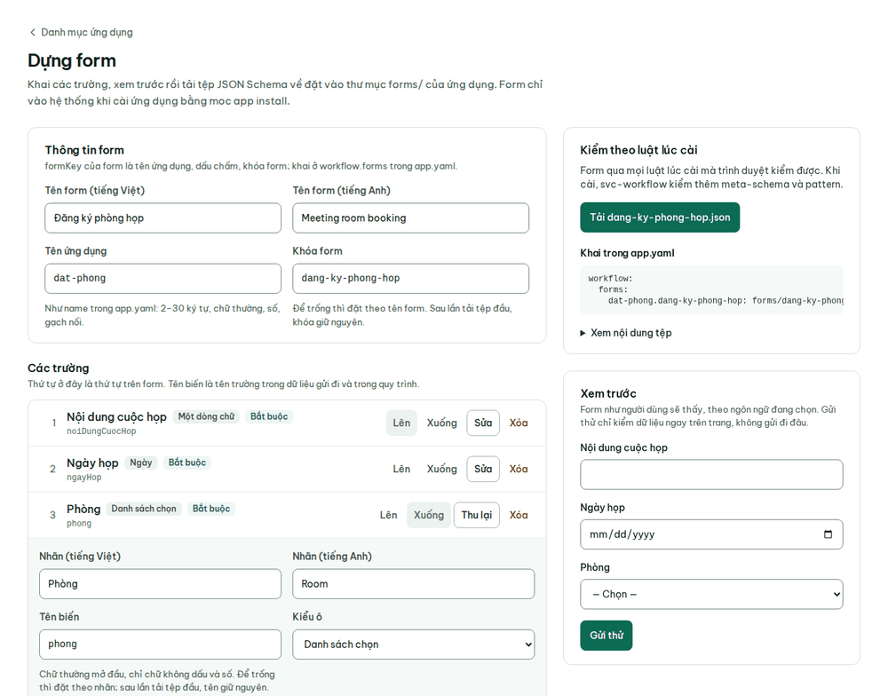
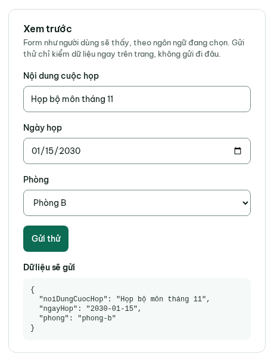

# Hướng dẫn cho quản trị đơn vị

Vai trò `tenant_admin`, thường là cán bộ CNTT của đơn vị. Tài khoản mẫu: `quantri` (Trường CNTT & TT). Đăng nhập cần
mã xác thực hai bước.

Quản trị đơn vị không đọc nội dung văn bản. Vì vậy menu không có Hộp việc, Văn bản đến, Văn bản đi, Hồ sơ công việc,
Sổ đăng ký. Chuông thông báo vẫn có: cảnh báo vận hành của hệ thống (Alertmanager) gửi về chuông của quản trị đơn vị
(#284). Nếu gõ thẳng địa chỉ các trang đó, hệ thống đưa bạn về Sổ kiểm toán. Không
gian cá nhân và Bảng tin cũng không mở được với tài khoản này.

Menu gồm: Tìm kiếm, Sổ kiểm toán, Ứng dụng, Góp ý. Nút **Góp ý** và nút đổi ngôn ngữ trên thanh trên cùng dùng như
mọi vai trò ([Việc chung](viec-chung.md#góp-ý)).

## Sổ kiểm toán

Đăng nhập xong là vào thẳng **Sổ kiểm toán**. Sổ ghi mọi thay đổi dữ liệu của đơn vị, nối thành chuỗi băm SHA-256:
sửa hay xóa lén một dòng đều bị phát hiện.

1. Đầu trang cho biết chuỗi đã được neo ra ngoài cơ sở dữ liệu tới dòng nào, lúc nào. Mỗi lần neo, hệ thống chép băm
   của dòng mới nhất ra kho lưu trữ khóa ghi, không ai sửa hay xóa được, kể cả quản trị.
2. Chọn nhóm cần xem bằng các tab: Tất cả, Văn bản, Giao việc, Tệp, "Người dùng, quyền xem", Danh mục.
3. Mỗi dòng có **Thời điểm**, **Người thực hiện**, **Thao tác**, **Thay đổi**, **Dòng sổ**. Bấm **Xem thêm** để tải
   các dòng cũ hơn.

Với văn bản hạn chế, sổ không hiện giá trị các trường nội dung. Quản trị đơn vị không mở được văn bản từ sổ. Kiểm cả
chuỗi từ đầu tới cuối là việc của người vận hành máy chủ, bằng lệnh `make audit`. Cách chuỗi băm và mốc neo hoạt
động: [`db/README.md`](../../db/README.md#sổ-kiểm-toán-chuỗi-băm),
[`van-hanh.md`](../van-hanh.md#mốc-neo-công-khai).

## Danh mục ứng dụng

1. Mở **Ứng dụng**. Trang chia ba nhóm: **Có sẵn trong lõi**, **Cài bằng manifest**, **Đã gỡ**.
2. Mỗi ứng dụng cài bằng manifest có **Băm manifest**: mã SHA-256 của tệp `app.yaml` lúc cài. Bấm **Chép** rồi so với
   kết quả lệnh `sha256sum` chạy trên tệp `app.yaml` của ứng dụng đó trên máy chủ (ví dụ
   `sha256sum apps/bang-tin/app.yaml`). Hai mã trùng nhau nghĩa là bản đang cài đúng là bản đã duyệt.

Cài và gỡ ứng dụng là việc của người vận hành máy chủ: [`them-ung-dung.md`](../them-ung-dung.md).

## Dựng form cho ứng dụng

Ứng dụng cài thêm (đơn nghỉ phép, đăng ký phòng họp…) khai form bằng một tệp JSON Schema. Trang **Dựng form** giúp
viết tệp đó mà không cần gõ JSON: khai các trường, xem trước, rồi tải tệp về. Chỉ quản trị đơn vị thấy trang này; vai
trò khác mở thẳng đường dẫn thì gặp câu "Chỉ quản trị đơn vị dùng trang này."

1. Mở **Ứng dụng**, bấm **Dựng form** (trang `/ung-dung/dung-form`).
2. **Thông tin form**: tên form tiếng Việt và tiếng Anh, **Tên ứng dụng** (đúng `name` trong `app.yaml` của ứng dụng,
   2–30 ký tự chữ thường, số, gạch nối) và **Khóa form**. Để trống khóa thì trang đặt theo tên form, vd "Đăng ký phòng
   họp" → `dang-ky-phong-hop`.
3. **Các trường**: chọn kiểu ô ở cuối trang rồi bấm **Thêm trường**. Có bảy kiểu: Một dòng chữ, Nhiều dòng chữ,
   Ngày, Số, Danh sách chọn, Chọn một trong vài nút, Ô đánh dấu. Bấm **Sửa** ở một trường để khai nhãn tiếng Việt và
   tiếng Anh, gợi ý dưới ô, bắt buộc hay không, và phần riêng của từng kiểu: số ký tự tối thiểu, tối đa (ô chữ), chỉ
   số nguyên, nhỏ nhất, lớn nhất (ô số), không sau hay không trước hôm nay, không trước ngày ở một trường khác (ô
   ngày), các lựa chọn với nhãn và giá trị lưu (danh sách, nút chọn).
4. **Tên biến** của trường tự đặt theo nhãn tiếng Việt: bỏ dấu, viết liền, vd "Nội dung cuộc họp" → `noiDungCuocHop`.
   Từ lần tải tệp đầu, tên biến, khóa form và giá trị lựa chọn giữ nguyên dù sau đó sửa nhãn, để quy trình đã viết
   theo tệp đó không đổi nghĩa.
5. Đổi thứ tự bằng nút **Lên**, **Xuống** (dùng được bằng bàn phím); **Xóa** bỏ một trường.

6. Cột phải **Kiểm theo luật lúc cài** đếm lỗi theo đúng luật hệ thống dùng khi cài ứng dụng; bấm một lỗi để nhảy tới
   ô cần sửa. Hết lỗi thì nút **Tải `<khóa>.json`** bật, kèm đoạn khai cho `app.yaml` và **Xem nội dung tệp**.
7. **Xem trước** hiện form đúng như người dùng sẽ thấy, theo ngôn ngữ đang chọn. **Gửi thử** chỉ kiểm dữ liệu ngay
   trên trang và hiện **Dữ liệu sẽ gửi**, không gửi đi đâu.

Trang không lưu form lên hệ thống. Tải tệp về rồi chuyển cho người vận hành máy chủ: họ đặt tệp vào
`apps/<ứng dụng>/forms/`, chép đoạn khai vào `app.yaml` và chạy `moc app install`; lúc đó hệ thống kiểm lại toàn bộ,
kể cả hai phần trình duyệt không kiểm được
([`them-ung-dung.md`](../them-ung-dung.md#110-quy-trình-của-ứng-dụng-workflow-301)).
Bản đang dựng chỉ giữ trong thẻ trình duyệt đang mở, kể cả khi phải đăng nhập lại; rời trang, đóng thẻ hay đăng xuất
là mất, nên tải tệp về trước khi đi.

## Tổng hợp góp ý

Mở **Góp ý** trên menu. Phần **Tổng hợp của đơn vị** có điểm trung bình, số góp ý, phân bố theo mức, theo màn hình và
các góp ý gần đây. Trang không hiện tên người gửi, chỉ hiện giờ gửi. Trên đơn vị mẫu (dữ liệu nạp bằng `make seed`),
các góp ý này là của người dùng thử hệ thống.

## Phòng ban và tên đơn vị

Giao diện chưa có màn hình cho việc này. Vai trò quản trị đơn vị có quyền thêm, sửa phòng ban và sửa tên đơn vị qua API
GraphQL. Danh sách thao tác được phép: [`thao-tac-theo-vai-tro.md`](../api/thao-tac-theo-vai-tro.md). Cách gọi API:
[`api/README.md`](../api/README.md).

## Việc của người vận hành máy chủ

Quản trị đơn vị khác người vận hành máy chủ. Các việc sau làm trên máy chủ, không làm trên giao diện:

- Tạo đơn vị mới, tạo tài khoản người dùng trong Keycloak: [`van-hanh.md`](../van-hanh.md#thêm-đơn-vị-thuê-ước).
- Sao lưu, khôi phục, két bí mật, giám sát: [`van-hanh.md`](../van-hanh.md).
- Cài đặt, nâng cấp: [`trien-khai.md`](../trien-khai.md).
